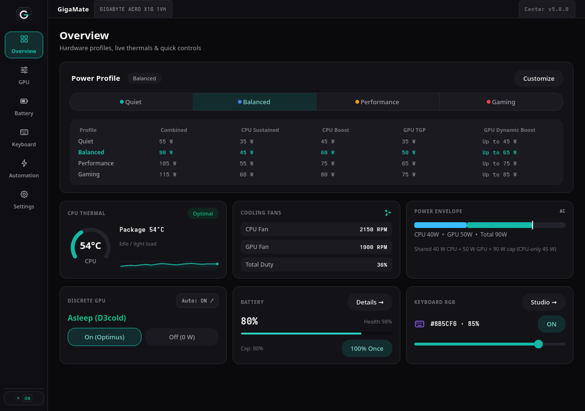
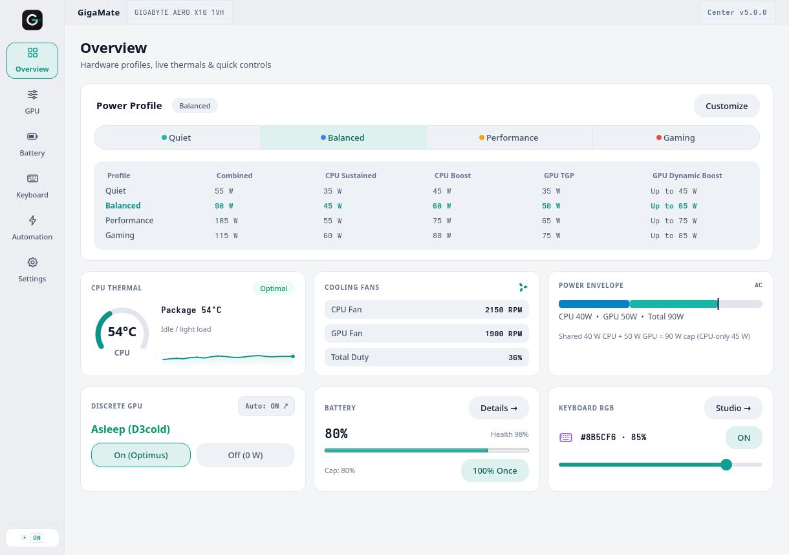
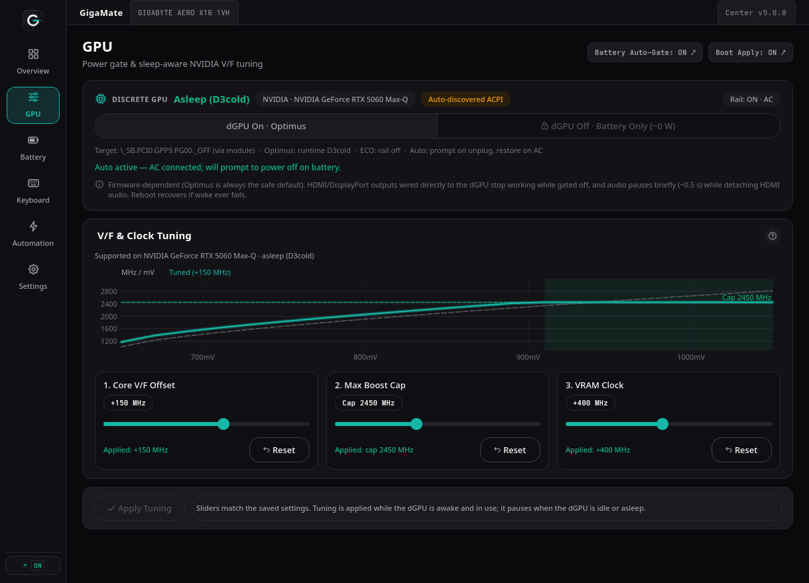
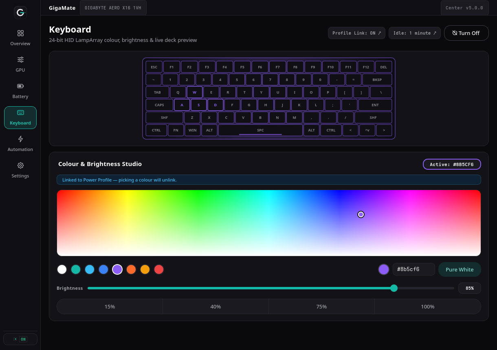
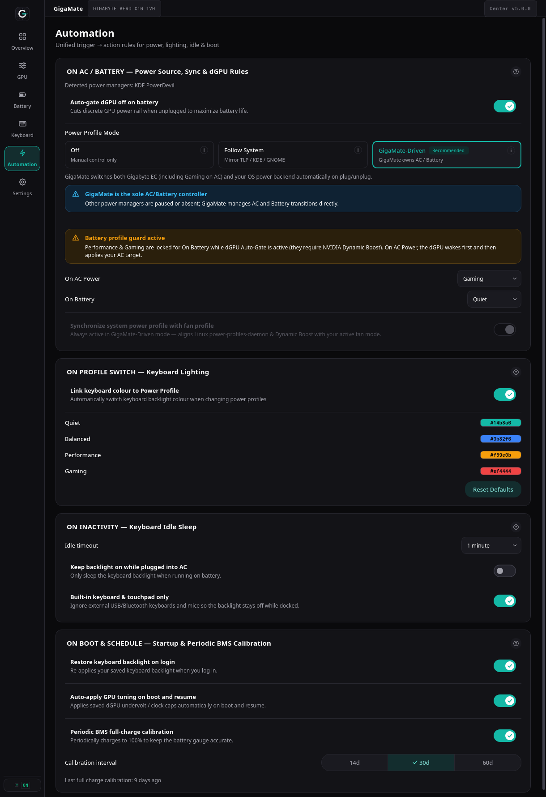
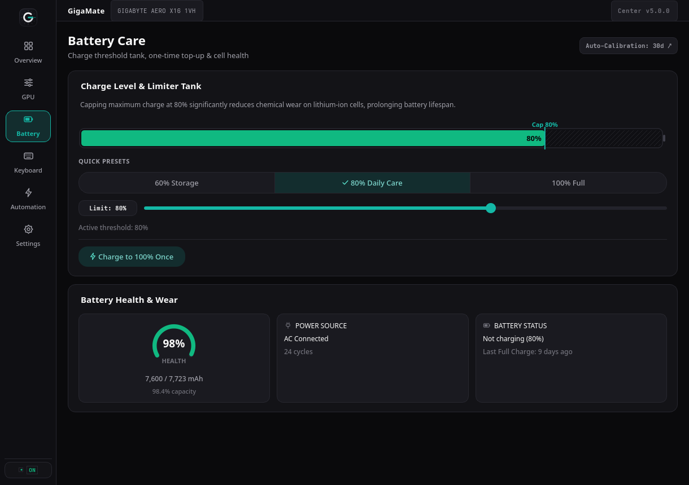
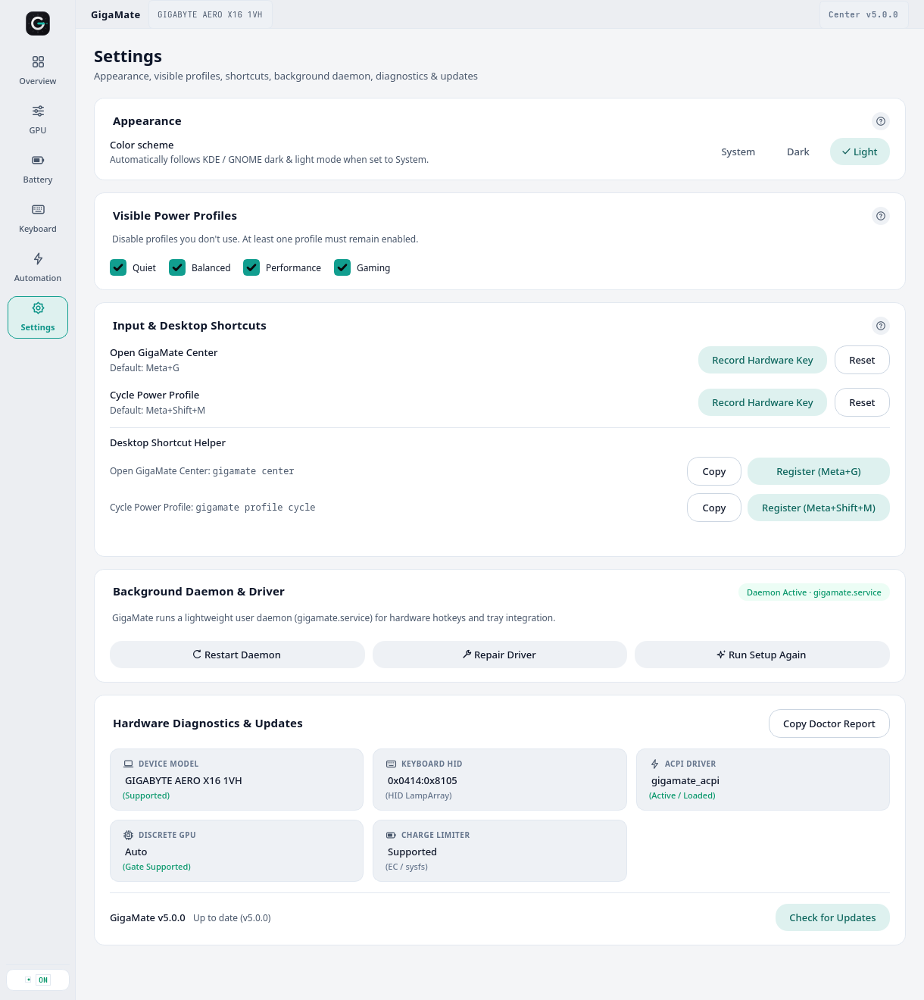

# GigaMate 5.0.0

**Zero-profile automatic hardware discovery and control center for modern Gigabyte & AORUS laptops on Linux.**

GigaMate 5.0.0 discovers your laptop's ACPI power profiles, per-profile Watt limits, 24-bit HID LampArray keyboard lighting, discrete GPU power gate, hardware hotkeys, and battery charge thresholds directly from live firmware and Linux sysfs at startup — **with zero static laptop JSON files, zero manual calibration wizards, zero `pyusb` driver detaching, and a pure-Python + PyQt6 stack (no GTK3 or AppIndicator3 dependencies)**.

---

## Live Control Center (Aero Instrument UI)

GigaMate Center automatically follows your desktop's **Dark & Light color scheme** (or lets you choose **System / Dark / Light** in Settings) and accents the UI to match your active thermal profile.

| Dark Mode | Light Mode |
| :---: | :---: |
|  |  |

<details>
<summary><strong>More Screenshots — GPU Power Gate & V/F Tuning, Keyboard RGB Studio, Automation Hub, Battery Care & Settings</strong></summary>

#### Discrete GPU Power Gate & Sleep-Aware V/F Curve Tuning


#### 24-Bit HID LampArray Keyboard Studio


#### Automation Hub — AC/Battery Rules, Profile Lighting, Idle Sleep & BMS Calibration


#### Battery Care & Limiter Tank


#### Settings, Appearance, Hotkeys & Hardware Diagnostics (Light Mode)


</details>

---

## Important Compatibility & Safety Notices

> [!IMPORTANT]
> ### Pre-2025 Legacy Models — Use GigaMate `v4.5.x`
> GigaMate 5.0.0 dropped the legacy pre-2025 vendor `0x08` RGB protocol and static model JSON files (`profile_data/*.json`) in favor of pure automatic firmware/HID discovery.
> If your laptop uses a pre-LampArray keyboard or a legacy BIOS without `WMBD(0xED)`, install or roll back to the final **`v4.5.x`** release (`v4.5.3`):
> ```sh
> curl -fsSL https://raw.githubusercontent.com/goodeesh/GigaMate/v4.5.3/install.sh | bash -s -- --tag v4.5.3
> ```
> See [Upgrading from v4.5.x & Rolling Back](docs/FAQ.md#upgrading-from-v45x--rolling-back) before upgrading.

> [!WARNING]
> ### Discrete GPU Power Gate (`ECO` / `Auto`) — Firmware-Dependent Hardware Notice
> **Optimus** is always the default and safest mode (leaving runtime D3cold to your kernel and NVIDIA/AMD drivers).
>
> **ECO** and **Auto** cut the discrete GPU PCIe power rail via auto-discovered ACPI methods (`_OFF`/`_PS3`) and remove the PCI device (`remove_before_off`) for ~0 W idle draw:
> - **Hardware testing scope:** Extensively verified on **GIGABYTE AERO X16 1VH** (AMD Strix Point + NVIDIA Blackwell RTX 5060 Max-Q). Other Gigabyte/AORUS models may behave differently depending on motherboard DSDT/EC firmware and PCIe bridge topology.
> - **Cross-laptop kernel & bridge guards:** Model-specific EC timeout recovery (`EC0.DSMD`) in `gigamate_acpi` is strictly gated by DMI (`GIGABYTE` + `AERO X16`) + ACPI handle verification (`\_SB.PCI0.SBRG.EC0.DSMD`), and PCIe Secondary Bus Reset (`reset_subordinate`) only runs when the root port hosts **no bound drivers** and **no non-dGPU sibling devices**.
> - **Expected hardware effects while gated off:** External HDMI/DisplayPort outputs wired directly to the dGPU stop working until restored; desktop audio pauses briefly (~0.5 s) while PipeWire/WirePlumber temporarily detaches the GPU HDMI audio node; Performance and Gaming profiles lock on battery because Dynamic Boost requires the dGPU.
> - **Recovery:** On rare firmware hangs, a normal reboot restores the discrete GPU cleanly. See the [dGPU Power Gate Safety FAQ](docs/FAQ.md#dgpu-power-gate-safety--troubleshooting) for details.

---

## What's New in 5.0.0

- **Zero-Profile Firmware & HID Discovery:** Inspects `WMBD(0xED)` AML bytecode and `\_SB.NPCF` via `gigamate_acpi` (`wmbd_aml`), validates BIOS support automatically, and discovers 2, 3, or 4 firmware profiles plus per-profile CPU sustained/burst, GPU TGP, Dynamic Boost, and combined Watt limits.
- **Aero Instrument UI with Dark & Light Modes:** Responsive Material-inspired interface with circular thermal arc gauges, thermal sparklines, interactive Power Envelope budget bars, live V/F curve plots, Battery Tank meter, and automatic KDE/GNOME **Dark & Light** theme following.
- **Pure-Python Daemon & Stateless PyQt6 System Tray:** Replaced the legacy GTK3 / `AppIndicator3` monolith with `gigamate.daemon` + Qt6 `QSystemTrayIcon` (zero `PyGObject` or GTK3 dependency required).
- **dGPU Power Gate & Recovery (`Optimus` / `ECO` / `Auto`):**
  - Wakes suspended NVIDIA GPUs cleanly before stopping `nvidia-powerd`, verifies zero open `/dev/nvidia*` or ALSA holders, removes PCI functions before cutting ACPI power, and supports interactive holder confirmation (`DgpuGateConfirmDialog`).
  - Restores full PCIe link width (up to Gen4 `x8` / `x16`) on wake via autoprobe pause + unbound-only SBR/LNKCTL retrain + AERO X16 `PG00._ON` timeout recovery.
- **Sleep-Aware NVIDIA V/F Tuning:** Core V/F curve offset (`0..+255 MHz`), Boost clock cap flattening, and VRAM clock offset (`-1000..+2000 MHz`) applied only while the dGPU is awake and paused cleanly when sleeping or gated off.
- **Automation Hub & Wayland Idle Intelligence:**
  - **Off / Follow System / GigaMate-Driven** AC/Battery rule engine with locked system power sync in GigaMate-Driven mode and reversible TLP / KDE PowerDevil / `power-profiles-daemon` hand-off.
  - **Built-in keyboard & touchpad only** idle mode (plus `/dev/hidraw*` `input0` bypass for **Toshy** / `xwaykeyz`) so docked external keyboards don't unexpectedly trigger laptop backlight wake.
  - **Profile-Linked RGB Lighting** (with auto-unlink on manual colour pick) and **Periodic BMS Full-Charge Calibration**.

---

## Installation & Upgrading

### Fresh Install

**Option A — Clone and inspect locally (recommended):**

```sh
git clone https://github.com/goodeesh/GigaMate.git
cd GigaMate
./install.sh
```

**Option B — One-line installer (latest stable release):**

```sh
curl -fsSL https://raw.githubusercontent.com/goodeesh/GigaMate/main/install.sh | bash
```

> [!NOTE]
> Run `./install.sh` as your **normal desktop user** (never with `sudo ./install.sh`). The script installs Python packages and systemd user units in user space, and only invokes `sudo` for system dependencies, DKMS module build, `/etc/udev/rules.d/`, and `/usr/lib/gigamate/` helpers.

### Upgrading from `v4.5.x` → `v5.0.0`

Upgrading preserves `~/.config/gigamate/config.json` (your colour, brightness, charge threshold, GPU offsets, and idle settings) and leaves your old `~/.config/gigamate/profiles/` folder untouched on disk in case you ever decide to roll back.

Run either:

```sh
gigamate update
```

or from a local checkout:

```sh
git pull
./install.sh --update
```

**What changes automatically during the upgrade:**
1. System packages switch from GTK3/`AppIndicator3`/`pyusb` to **PyQt6** (while cleanly cleaning up old `pip --user` installs and migrating into an isolated `--system-site-packages` `pipx` environment).
2. `gigamate_acpi` rebuilds via DKMS for every installed kernel (running kernel first) and prunes stale unreferenced DKMS versions.
3. If `./install.sh` detects a **pre-LampArray keyboard** or a **non-`WMBD(0xED)` BIOS**, it displays a prominent compatibility notice at the end with the exact `v4.5.3` rollback command.

### Rolling Back to `v4.5.3`

If you own a pre-2025 laptop or prefer `v4.5.x`, roll back cleanly at any time:

```sh
curl -fsSL https://raw.githubusercontent.com/goodeesh/GigaMate/v4.5.3/install.sh | bash -s -- --tag v4.5.3
```

Because GigaMate 5.0 preserves unknown `v4.x` keys on disk inside `config.json` and never deletes `~/.config/gigamate/profiles/`, rolling back restores your `v4.5.3` configuration automatically.

### Secure Boot Systems

DKMS signs `gigamate_acpi.ko` using the system DKMS Machine Owner Key (MOK). On Secure Boot laptops, enroll the key once so the driver loads after reboot:

```sh
sudo mokutil --import /var/lib/dkms/mok.pub
```

Reboot and choose **Enroll MOK** in the EFI prompt. After kernel upgrades, if the module ever fails to load, click **Repair Driver** in Settings or run `gigamate repair`.

### Uninstalling

```sh
./uninstall.sh
```

Remove remaining user configuration (optional):

```sh
rm -rf ~/.config/gigamate ~/.config/gigabyte-keyboard-rgb
```

---

## CLI Reference

Run `gigamate --help` or `gigamate <subcommand> --help` for full options.

| Command | Description |
| :--- | :--- |
| `gigamate center` *(or `gigamate gui`)* | Launch **GigaMate Center** GUI |
| `gigamate tray` | Start the PyQt6 system tray & automation daemon |
| `gigamate status` | Show model, keyboard RGB, ACPI temperatures/fans, active profile, Watt limits & dGPU state |
| `gigamate doctor` | Run full diagnostics (`gigamate_acpi`, `wmbd_aml`, `diagnose_lamparray`, udev ACLs, polkit, services) |
| `gigamate detect [--acpi]` | Detect keyboard HID and probe ACPI interfaces |
| `gigamate profile [NAME \| set NAME \| cycle \| report]` | Show, set (`quiet`/`balanced`/`performance`/`gaming`), cycle, or print hardware discovery report |
| `gigamate rgb static <COLOUR\|#RRGGBB> [5..100]` | Set 24-bit keyboard colour and brightness percentage (`0` turns off) |
| `gigamate rgb off` | Turn keyboard backlight off |
| `gigamate rgb detect` / `gigamate rgb cycle` | Scan for LampArray keyboards or cycle palette colours |
| `gigamate rgb idle <off\|10\|30\|60\|120\|300\|900>` | Configure keyboard idle auto-off timeout in seconds |
| `gigamate gpu status` | Show discrete GPU state, runtime PM, power gate & Dynamic Boost / SmartShift |
| `gigamate gpu power <status\|optimus\|eco\|auto\|off\|on\|probe\|sync>` | Manage dGPU power gate (`--live-test` with `probe`; `--force-close` with `off`/`eco`/`auto`) |
| `gigamate gpu undervolt [0..255\|off\|status]` | Configure sleep-aware NVIDIA Core V/F offset (`--probe`, `--auto`, `--no-auto`) |
| `gigamate gpu maxclock [MHz\|off\|status]` | Configure sleep-aware NVIDIA boost clock cap (`--probe`) |
| `gigamate gpu memoffset [-1000..2000\|off\|status]` | Configure sleep-aware NVIDIA VRAM V/F offset (`--probe`) |
| `gigamate battery [--limit 40..100] [--topup \| --cancel-topup]` | View battery health, set charge cap, run 100% top-up, or configure `--auto-topup on\|off` |
| `gigamate hotkeys [list \| watch]` | Inspect hardware hotkey signatures or stream raw HID events |
| `gigamate repair [--status]` | Rebuild and reload `gigamate_acpi` for the running kernel via polkit helper |
| `gigamate update [--check] [--yes]` | Check for or apply updates from GitHub releases |

---

## Documentation

- **[User Guide](docs/USER_GUIDE.md)** — Walkthrough of every page, setting, tray menu action, and workflow.
- **[Frequently Asked Questions (FAQ)](docs/FAQ.md)** — Hardware support, `v4.5.x` upgrades, dGPU Power Gate safety, Wayland/Toshy idle detection, TLP/PowerDevil sync, and troubleshooting.
- **[Hardware Discovery Architecture](docs/HARDWARE_DISCOVERY.md)** — Deep dive into `WMBD(0xED)` AML parsing, `NPCF`, HID LampArray, dGPU PCIe/ACPI topology, and safety guards.
- **[RGB Protocol Notes](docs/RGB_PROTOCOL.md)** — HID LampArray `Usage Page 0x59` report layout, udev `uaccess` permissions, and historical `0x08` reference.
- **[Contributing](CONTRIBUTING.md)** — Bug report requirements (`gigamate doctor` + `gigamate profile report`), local dev environment, and running `pytest`.
