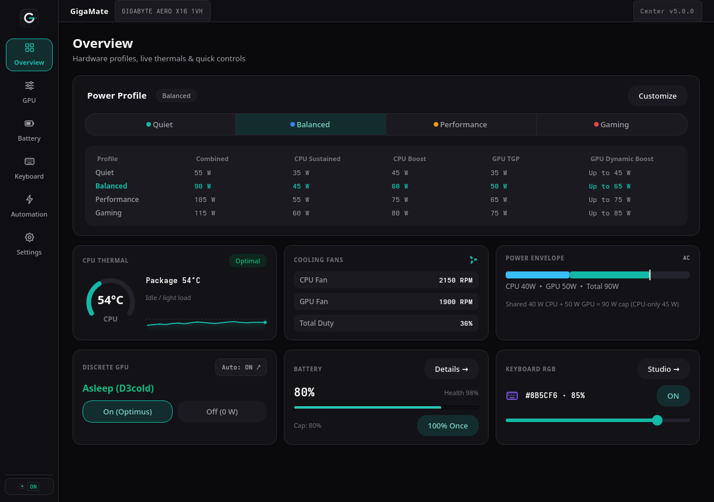
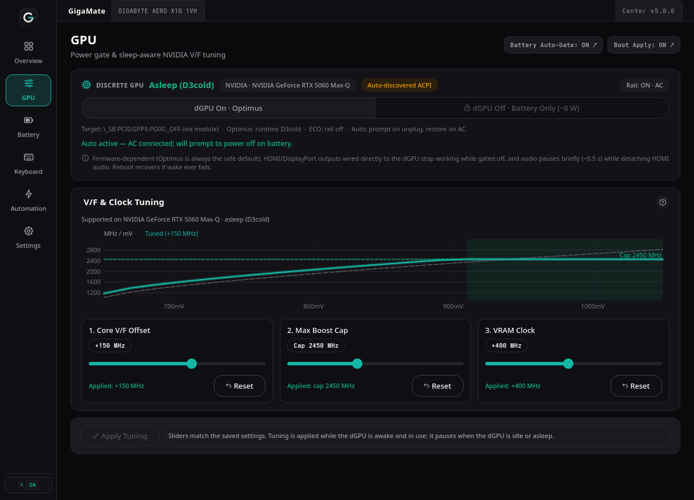
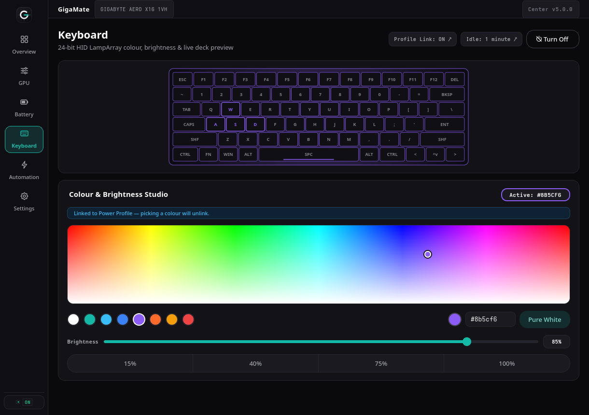
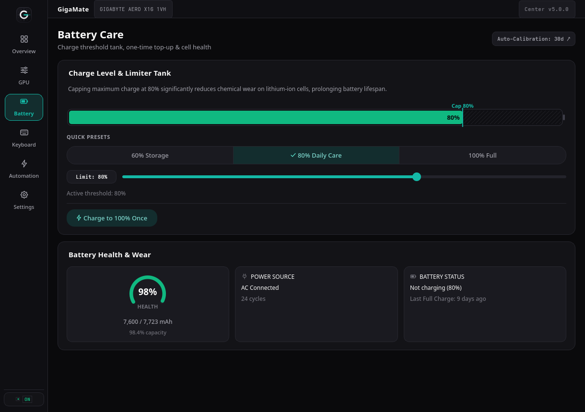
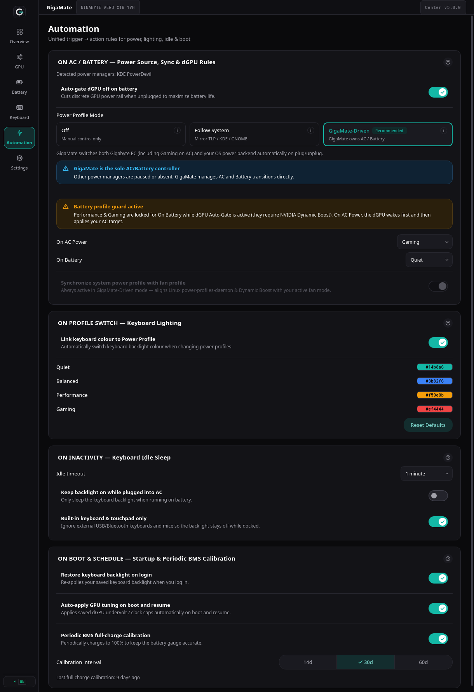
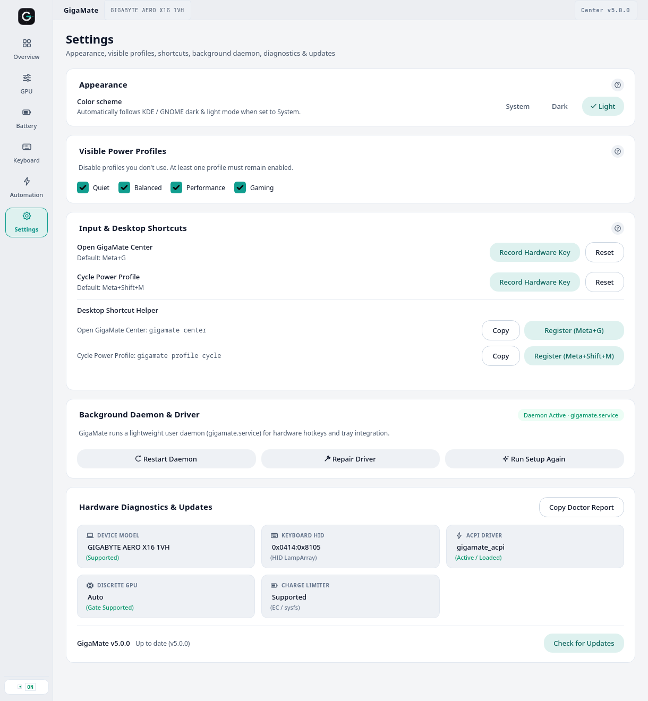

# GigaMate 5.0.0 — User Guide

This guide walks through every page and capability of **GigaMate Center**, the **System Tray**, and key **CLI** workflows in GigaMate 5.0.0.

---

## 1. Overview & Thermal Power Profiles



- **Hero Power Profile Switcher:** Displays only the ACPI profiles exposed by your BIOS (`WMBD(0xED)`) — typically **Quiet**, **Balanced**, **Performance**, and **Gaming**.
  - Click **Customize** (top right of the Power Profile card) to hide unused profiles in **Settings → Visible Power Profiles**.
- **Power Limits Comparison Matrix:** Shows the exact per-profile **Combined**, **CPU Sustained (PL1)**, **CPU Boost (PL2)**, **GPU TGP**, and **GPU Dynamic Boost** ceilings discovered directly from your firmware AML (and automatically reflects reduced battery limits when unplugged).
- **Live Telemetry Band:**
  - **CPU Thermal:** Arc gauge + 30-sample rolling sparkline + thermal state pill (`Optimal` / `Active` / `Warm`).
  - **Cooling Fans:** Live CPU & GPU fan RPMs, total PWM duty percentage, and an RPM-responsive spinning fan indicator.
  - **Power Envelope:** Visual bar comparing CPU shared wattage vs. GPU wattage against your laptop's peak thermal envelope.
- **Quick Hardware Strip:** Instant toggles for **Discrete GPU** (`On (Optimus)` / `Off (0 W)` on battery), **Battery Care** (`100% Once` top-up), and **Keyboard RGB** (on/off toggle + 5–100% slider), with deep links (`↗`) straight to their Automation rules.

---

## 2. Discrete GPU — Power Gate & Sleep-Aware Tuning



### Hardware Power Gate (`Optimus` vs `ECO` / `Auto`)

- **dGPU On · Optimus (Safe Default):** Keeps the dGPU enumerated on PCI while Linux runtime PM (`D3cold`) puts it to sleep whenever idle.
- **dGPU Off · Battery Only (~0 W):** Immediately opens the **dGPU Power Gate confirmation dialog** showing any apps/services holding `/dev/nvidia*` or blocking external dGPU displays, then detaches the PCI functions and cuts the ACPI power rail.
  - Available on **battery power only** (locked on AC to prevent accidentally cutting your GPU while plugged in).
  - Switching back to **Optimus** (or plugging in AC in **Auto** mode) restores ACPI power, verifies full PCIe link width (e.g. `PCIe 4.0 x8`), re-probes drivers, and restarts `nvidia-powerd` for full Dynamic Boost.

> [!NOTE]
> The **Auto-discovered ACPI** pill shows which firmware resource GigaMate found (`\_SB.PCI0.GPP9.PG00._OFF` etc.) along with a safety tooltip reminding that rail gating is firmware-dependent (verified on AERO X16 1VH). You can test discovery safely on your model via:
> ```sh
> gigamate gpu power probe
> gigamate gpu power probe --live-test   # idle AC, no external displays attached
> ```

### Sleep-Aware NVIDIA V/F Tuning

GigaMate adjusts NVIDIA clocks cleanly without interfering with runtime `D3cold`:
1. **Core V/F Offset (`0..+255 MHz`):** Shifts the voltage-frequency curve up so the GPU hits target clocks at lower voltage (cooler temperatures & higher boost sustained within TDP).
2. **Max Boost Cap:** Flattens the top of the V/F curve above a chosen MHz ceiling to eliminate peak-boost voltage/heat spikes when pairing an aggressive curve offset.
3. **VRAM Clock (`-1000..+2000 MHz`):** Signed memory frequency offset.
4. Click **Apply Tuning** to commit staged sliders together (or **Discard** to revert). Use **Reset** beside any individual card to return that setting to stock immediately.

> [!TIP]
> Ensure **Boot Apply: ON** is enabled (links to **Automation → ON BOOT & SCHEDULE**) so the background watcher re-applies your saved tuning automatically whenever the dGPU wakes under load and clears it cleanly before sleep.

### USB-C PD Power Budget (Opt-In)

When plugged into a `>= 90 W` USB-C Power Delivery charger, NVIDIA drivers normally lock the dGPU to a 30 W "Undersized Power Source" Aux Power State. Enabling **USB-C PD Power Budget** (with a one-time safety confirmation) unlocks higher GPU wattage while protecting your charger and battery:
- **Configurable Safety Buffer (`15%–25%`, default `25%`, min `15 W`):** Reserves power for the display, chassis electronics, and VRM conversion losses, clamping CPU + GPU limits inside the remaining silicon budget.
- **Closed-Loop Battery Drain Guard:** If sustained battery drain exceeds `3 W` for `5 s` (or battery drops below `15%`), GigaMate automatically trims CPU then GPU limits and steps back toward 30 W / 20 W.
- **Automatic Stock Restoration:** Unplugging or switching back to barrel AC restores stock firmware limits immediately.
- CLI: `gigamate gpu usbc-budget status`, `gigamate gpu usbc-budget on`, `gigamate gpu usbc-budget set 60`, `gigamate gpu usbc-budget buffer 20`.

---

## 3. Keyboard Studio (24-Bit HID LampArray RGB)



- **Live Keyboard Deck Preview:** Real-time backlit preview reflecting your active hue, saturation, brightness percentage (`5–100%`), and on/off state.
- **Colour & Brightness Studio:**
  - Drag anywhere on the 2D **Hue × Saturation** colour pad, click any quick colour swatch (including **Pure White**), or enter any exact `#rrggbb` hex code.
  - Brightness uses a **5% minimum active floor** (`5–100%`) so colours never shift hue from extreme 8-bit integer rounding; use **Turn Off / Turn On** (top right) for zero backlight.
  - Deep-link pills (**Profile Link** and **Idle timeout**) jump straight to the matching cards on the **Automation** page and glow-highlight the target section.
  - If **Profile Link** is enabled in Automation, picking any manual colour in Keyboard Studio automatically unlinks profile lighting so your custom pick isn't overwritten.
  - Pressing the laptop's **Fn keyboard backlight** key cycles brightness (`Off` → `15%` → `50%` → `100%`) and displays an on-screen OSD indicator (also available via `gigamate rgb brightness-cycle`).

---

## 4. Battery Care



- **Charge Level & Limiter Tank:** Shows current charge level, active threshold cap line, and one-click presets (**60% Storage**, **80% Daily Care**, **100% Full**), plus fine-grained **40–100%** slider control.
- **Charge to 100% Once:** Temporarily lifts the threshold for a single full charge before travel, then automatically restores your configured cap (`80%` / `60%`) once full.
- **Battery Health & Wear:** Displays radial health %, design vs. full-charge capacity (`mAh`), cycle count, power source, and time since the last full calibration charge.

---

## 5. Automation Hub



Organizes every background rule into four clear Trigger → Action cards:

1. **ON AC / BATTERY — Power Source, Sync & dGPU Rules**
   - **Auto-gate dGPU off on battery (`auto` mode):** Prompts with a live confirmation window whenever AC is unplugged so you can close GPU apps (or keep the dGPU on for that session while keeping Auto mode enabled), and automatically wakes the GPU back up when AC returns.
   - **Power Profile Mode:**
     - **Off:** Manual control only.
     - **Follow System:** Mirrors TLP, KDE PowerDevil, or GNOME `power-profiles-daemon` changes into Gigabyte EC + linked RGB.
     - **GigaMate-Driven:** GigaMate owns AC (`On AC Power`, including Gaming) and Battery (`On Battery`) transitions directly, locking **Synchronize system power profile with fan profile** ON so firmware and Linux never drift out of sync. If external power tools conflict, click **Deactivate Conflicts (Take Over)** (fully reversible with **Restore Paused Power Managers**).
2. **ON PROFILE SWITCH — Keyboard Lighting**
   - Assign distinct `#rrggbb` colours to **Quiet**, **Balanced**, **Performance**, and **Gaming**; switching profiles updates your keyboard backlight automatically.
3. **ON INACTIVITY — Keyboard Idle Sleep**
   - Automatically turns off the keyboard backlight after `10s`, `30s`, `1m`, `2m`, `5m`, or `15m` of inactivity and restores it instantly on activity.
   - **Keep backlight on while plugged into AC:** Sleep lighting only on battery.
   - **Built-in keyboard & touchpad only:** Ignores external USB/Bluetooth peripherals when docked (using `evdev` + kernel `/dev/hidraw*` `input0` fallback for compatibility with **Toshy** / `xwaykeyz`).
4. **ON BOOT & SCHEDULE — Startup & Periodic BMS Calibration**
   - **Restore keyboard backlight on login** (`startup_apply`)
   - **Auto-apply GPU tuning on boot and resume** (`dgpu_undervolt_auto`)
   - **Periodic BMS full-charge calibration** (`14d` / `30d` / `60d` cadence)

---

## 6. Settings, Appearance, Hotkeys & Diagnostics



- **Appearance:** Choose **System** (automatically follows KDE/GNOME Dark & Light mode live), **Dark**, or **Light**.
- **Visible Power Profiles:** Uncheck profiles you never use (at least one always stays active); applies immediately across Overview, Tray, and Automation.
- **Input & Desktop Shortcuts:**
  - Click **Record Hardware Key** and press a Gigabyte Fn-hotkey / special button to capture its HID signature directly from the stream (Default fallback works out of the box on standard Gigabyte HID hotkeys).
  - Copy ready-to-bind commands (`gigamate center`, `gigamate profile cycle`) or click **Register** to register shortcuts directly with KDE/GNOME.
- **Background Daemon & Driver:** Check `gigamate.service` live state, click **Restart Daemon**, rebuild/reload `gigamate_acpi` cleanly via **Repair Driver**, or re-run the onboarding wizard (**Run Setup Again**).
- **Hardware Diagnostics & Updates:** View 5 live capability chips (**Device Model**, **Keyboard HID**, **ACPI Driver**, **Discrete GPU**, **Charge Limiter**), copy a full **`gigamate doctor`** report to clipboard, or check for new GitHub releases.

---

## 7. System Tray & CLI Quick Cheat Sheet

### PyQt6 System Tray (`gigamate-tray` / `gigamate.service`)

Right-clicking (or left-clicking) the tray icon gives instant access to:
- **GigaMate Center...** — Launch or raise the GUI window
- **Live Status Line** — Active CPU temperature, fan RPMs, and AC/Battery state
- **Power Profile** — Radio selector showing enabled profiles (locking Performance/Gaming cleanly when dGPU is gated off)
- **Backlight** submenu — Instant presets (`Off`, `5%`, `50%`, `100%`)
- **Update Available** banner (when a newer tagged GitHub release exists)

### Useful One-Liner Commands

```sh
gigamate status                          # Full hardware summary
gigamate profile balanced                # Switch EC profile (quiet/balanced/performance/gaming)
gigamate rgb static "#14b8a6" 75         # Set custom 24-bit colour at 75% brightness
gigamate rgb brightness-cycle            # Cycle backlight (Off / 15% / 50% / 100%)
gigamate rgb idle 60                     # Auto-sleep keyboard backlight after 60s idle
gigamate battery --limit 80              # Set 80% daily charge threshold
gigamate battery --topup                 # Charge to 100% once, then restore limit
gigamate gpu power eco                   # Cut dGPU rail on battery (prompts/checks safety)
gigamate gpu usbc-budget on              # Enable opt-in USB-C PD power budget (>= 90 W)
gigamate gpu power optimus               # Wake dGPU back onto PCI bus (full link width)
gigamate gpu undervolt 150               # Set +150 MHz sleep-aware Core V/F offset
gigamate gpu maxclock 2450               # Cap GPU boost clock at 2450 MHz
gigamate gpu memoffset 400               # Set +400 MHz VRAM V/F offset
gigamate doctor                          # Full diagnostics for troubleshooting
gigamate repair                          # Rebuild & reload gigamate_acpi for running kernel
```
