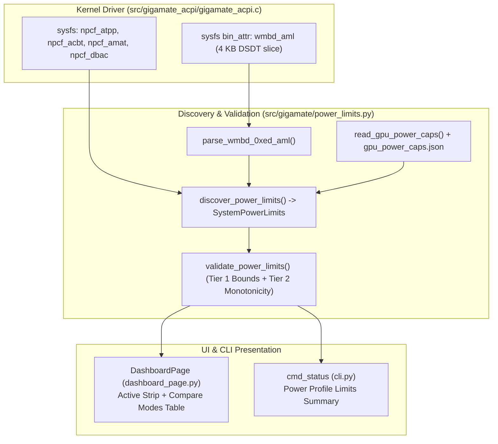

# Automatic Power-Limit Discovery & Dashboard Integration Implementation Plan

> **For agentic workers:** REQUIRED SUB-SKILL: Use superpowers:subagent-driven-development to implement this plan task-by-task. Steps use checkbox (`- [ ]`) syntax for tracking.

**Goal:** Automatically discover, sanity-check, and display per-profile hardware power limits (Combined CPU+GPU, CPU Sustained/Burst, GPU Fixed, GPU with Dynamic Boost) in GigaMate Center and CLI without external binaries (`ryzenadj`, `nvidia-smi`, `iasl`) or user-submitted DSDT files.

**Architecture:** A hybrid 3-layer pipeline: (1) [`gigamate_acpi.c`](file:///home/adriansc/Projects/GigaMate/src/gigamate_acpi/gigamate_acpi.c) exposes live `\_SB.NPCF.{ATPP,ACBT,AMAT,DBAC}` sysfs attributes plus a 4 KB read-only `wmbd_aml` slice of the `WMBD` method from the in-kernel DSDT; (2) [`src/gigamate/power_limits.py`](file:///home/adriansc/Projects/GigaMate/src/gigamate/power_limits.py) parses `WMBD (0xED)` AML bytecode, combines it with sleep-safe cached NVML GPU base/max TGP (or Intel RAPL / AMD `hwmon`), and runs a two-tier sanity validator (physical bounds + cross-profile monotonicity + live NVML cross-check); (3) [`DashboardPage`](file:///home/adriansc/Projects/GigaMate/src/gigamate/ui/pages/dashboard_page.py) renders the active profile's power strip and an expandable 4-mode comparison table, hiding any metric that fails validation.

**Architecture Diagram:**



**Tech Stack:** C (Linux kernel ACPI/sysfs API), Python 3.10+ (`dataclasses`, `ctypes` for `libnvidia-ml.so.1`, `pathlib`), PyQt6 (`QFrame`, `QGridLayout`, `QPushButton`), `pytest`.

**Spec:** [`docs/superpowers/specs/2026-04-19-power-limits-discovery-design.md`](file:///home/adriansc/Projects/GigaMate/docs/superpowers/specs/2026-04-19-power-limits-discovery-design.md)

## Global Constraints

- **Zero External Binaries:** Never shell out to `ryzenadj`, `nvidia-smi`, or `iasl`.
- **dGPU Sleep-Safety Invariant:** Never load or call `libnvidia-ml.so.1` unless `/sys/bus/pci/devices/<bdf>/power/runtime_status == "active"`. When `suspended` (`D3cold`/`D3hot`), read GPU base/max TGP exclusively from `CONFIG_DIR / "gpu_power_caps.json"`.
- **Rule of Clean Absence:** Any metric that is `None` or fails Tier 1 / Tier 2 sanity checks must be hidden in the UI (`setVisible(False)`), never shown as `0W`, `--`, or `Unknown`.
- **No Unprivileged Root Prompts at Runtime:** Reading `wmbd_aml`, `npcf_*`, `intel-rapl`, and cached NVML caps must work as a regular user without `sudo` or `pkexec`.

---

### Task 1: Expose Live `NPCF` Attributes and `wmbd_aml` Slice in `gigamate_acpi.c`

**Files:**
- Modify: [`src/gigamate_acpi/gigamate_acpi.c:22-30`](file:///home/adriansc/Projects/GigaMate/src/gigamate_acpi/gigamate_acpi.c#L22-L30)
- Modify: [`src/gigamate_acpi/gigamate_acpi.c:350-440`](file:///home/adriansc/Projects/GigaMate/src/gigamate_acpi/gigamate_acpi.c#L350-L440)
- Test: `tests/test_acpi_module_source.py`

**Interfaces:**
- Produces sysfs files under `/sys/devices/platform/gigamate_acpi/`:
  - `npcf_atpp`, `npcf_acbt`, `npcf_amat`, `npcf_dbac` (mode `0444`, integer in `1/8 W` units or `-ENODATA`)
  - `wmbd_aml` (mode `0444`, binary attribute up to `4096` bytes starting at `"WMBD"` in `DSDT`)

- [ ] **Step 1: Write the failing test verifying `gigamate_acpi.c` defines `NPCF` and `wmbd_aml` sysfs attributes and compiles**

Create `tests/test_acpi_module_source.py`:

```python
import shutil
import subprocess
from pathlib import Path

import pytest

REPO_ROOT = Path(__file__).resolve().parent.parent
MODULE_DIR = REPO_ROOT / "src" / "gigamate_acpi"
MODULE_SRC = MODULE_DIR / "gigamate_acpi.c"


def test_gigamate_acpi_exposes_npcf_and_wmbd_aml_attributes():
    src = MODULE_SRC.read_text(encoding="utf-8")
    for attr in ("npcf_atpp", "npcf_acbt", "npcf_amat", "npcf_dbac", "wmbd_aml"):
        assert attr in src, f"Missing sysfs attribute {attr} in gigamate_acpi.c"
    assert "\\\\_SB.NPCF.ATPP" in src
    assert "\\\\_SB.NPCF.ACBT" in src
    assert "\\\\_SB.NPCF.AMAT" in src
    assert "\\\\_SB.NPCF.DBAC" in src
    assert "ACPI_SIG_DSDT" in src


def test_gigamate_acpi_builds_against_running_kernel(tmp_path):
    kbuild = Path(f"/lib/modules/{Path('/proc/sys/kernel/osrelease').read_text().strip()}/build")
    if not kbuild.is_dir() or not shutil.which("make"):
        pytest.skip("Kernel headers or make not installed")
    for item in ("Makefile", "gigamate_acpi.c"):
        shutil.copy2(MODULE_DIR / item, tmp_path / item)
    res = subprocess.run(
        ["make", "-C", str(tmp_path)],
        capture_output=True,
        text=True,
        timeout=60,
    )
    assert res.returncode == 0, f"Kernel module build failed:\n{res.stderr}"
    assert (tmp_path / "gigamate_acpi.ko").is_file()
```

- [ ] **Step 2: Run test to verify it fails**

Run: `pytest tests/test_acpi_module_source.py -v`
Expected: FAIL with `AssertionError: Missing sysfs attribute npcf_atpp in gigamate_acpi.c`

- [ ] **Step 3: Implement `npcf_*` attributes and `wmbd_aml` binary attribute in [`src/gigamate_acpi/gigamate_acpi.c`](file:///home/adriansc/Projects/GigaMate/src/gigamate_acpi/gigamate_acpi.c)**

Update [`src/gigamate_acpi/gigamate_acpi.c`](file:///home/adriansc/Projects/GigaMate/src/gigamate_acpi/gigamate_acpi.c) to add `wmbd_aml_buf`, `acpi_npcf_read()`, the 4 `DEVICE_ATTR_RO(npcf_*)` attributes, and `bin_attr_wmbd_aml`:

```c
#define WMBD_AML_MAX_LEN 4096
static u8 wmbd_aml_buf[WMBD_AML_MAX_LEN];
static size_t wmbd_aml_len;
```

And add helper + attributes before `amw0_paths`:

```c
/* ────────────────────────────────────────────
 * Sysfs attributes — NVIDIA NVPCF (read-only) & WMBD AML slice
 * ──────────────────────────────────────────── */

static int acpi_npcf_read(const char *field)
{
	char path[32];
	unsigned long long val = 0;
	acpi_status status;

	snprintf(path, sizeof(path), "\\_SB.NPCF.%s", field);
	status = acpi_evaluate_integer(NULL, path, NULL, &val);
	if (ACPI_FAILURE(status))
		return -ENODATA;
	return (int)val;
}

#define DEFINE_NPCF_ATTR(lname, uname)					\
static ssize_t npcf_##lname##_show(struct device *dev,			\
				   struct device_attribute *attr,	\
				   char *buf)				\
{									\
	int val = acpi_npcf_read(#uname);				\
	if (val < 0)							\
		return val;						\
	return sysfs_emit(buf, "%d\n", val);				\
}									\
static DEVICE_ATTR_RO(npcf_##lname)

DEFINE_NPCF_ATTR(atpp, ATPP);
DEFINE_NPCF_ATTR(acbt, ACBT);
DEFINE_NPCF_ATTR(amat, AMAT);
DEFINE_NPCF_ATTR(dbac, DBAC);

static ssize_t wmbd_aml_read(struct file *filp, struct kobject *kobj,
			     const struct bin_attribute *attr, char *buf,
			     loff_t off, size_t count)
{
	if (wmbd_aml_len == 0)
		return -ENODATA;
	return memory_read_from_buffer(buf, count, &off, wmbd_aml_buf, wmbd_aml_len);
}

static const struct bin_attribute bin_attr_wmbd_aml = {
	.attr = { .name = "wmbd_aml", .mode = 0444 },
	.size = WMBD_AML_MAX_LEN,
	.read = wmbd_aml_read,
};

static void gigamate_cache_wmbd_aml(void)
{
	struct acpi_table_header *dsdt = NULL;
	acpi_status status;
	const u8 *base;
	u32 len, i;

	wmbd_aml_len = 0;
	status = acpi_get_table(ACPI_SIG_DSDT, 0, &dsdt);
	if (ACPI_FAILURE(status) || !dsdt || dsdt->length <= sizeof(*dsdt) + 4)
		return;

	base = (const u8 *)dsdt;
	len = dsdt->length;
	for (i = sizeof(*dsdt); i + 4 <= len; i++) {
		if (base[i] == 'W' && base[i + 1] == 'M' &&
		    base[i + 2] == 'B' && base[i + 3] == 'D') {
			size_t copy_len = len - i;
			if (copy_len > WMBD_AML_MAX_LEN)
				copy_len = WMBD_AML_MAX_LEN;
			memcpy(wmbd_aml_buf, base + i, copy_len);
			wmbd_aml_len = copy_len;
			break;
		}
	}
	acpi_put_table(dsdt);
}
```

Register `&dev_attr_npcf_atpp`, `&dev_attr_npcf_acbt`, `&dev_attr_npcf_amat`, `&dev_attr_npcf_dbac` in `gigamate_acpi_dev_attrs`, and in `gigamate_acpi_probe()` call `gigamate_cache_wmbd_aml()` and `device_create_bin_file(&pdev->dev, &bin_attr_wmbd_aml)` (with matching `device_remove_bin_file(&pdev->dev, &bin_attr_wmbd_aml)` in `gigamate_acpi_remove()`).

- [ ] **Step 4: Run test to verify it passes**

Run: `pytest tests/test_acpi_module_source.py -v`
Expected: PASS (2 passed)

- [ ] **Step 5: Commit**

```bash
git add src/gigamate_acpi/gigamate_acpi.c tests/test_acpi_module_source.py
git commit -m "feat(acpi): expose live NPCF power attributes and WMBD AML slice in sysfs"
```

---

### Task 2: AML `WMBD (0xED)` Parser and Two-Tier Sanity Validator

**Files:**
- Create: [`src/gigamate/power_limits.py`](file:///home/adriansc/Projects/GigaMate/src/gigamate/power_limits.py)
- Test: `tests/test_power_limits.py`

**Interfaces:**
- Produces in `src/gigamate/power_limits.py`:
  - `RawProfileAml`: `@dataclass(frozen=True)` with `profile_id: int`, `atpp_raw: Optional[int]`, `acbt_raw: Optional[int]`, `amat_raw: Optional[int]`, `dbac_raw: Optional[int]`, `ecpt_30_w: Optional[int]`, `ecpt_32_w: Optional[int]`, `ecpt_34_w: Optional[int]`
  - `ProfilePowerLimits`: `@dataclass(frozen=True)` with `profile_id: int`, `combined_w: Optional[int]`, `cpu_shared_w: Optional[int]`, `cpu_sustained_w: Optional[int]`, `cpu_burst_w: Optional[int]`, `gpu_fixed_w: Optional[int]`, `gpu_boost_w: Optional[int]`, property `has_any -> bool`
  - `SystemPowerLimits`: `@dataclass(frozen=True)` with `profiles: Dict[int, ProfilePowerLimits]`, `dynamic_boost_supported: bool`, `dynamic_boost_active: bool`, `on_battery: bool`, `source: str`
  - `parse_wmbd_0xed_aml(aml_bytes: bytes) -> Dict[int, RawProfileAml]`
  - `build_and_validate_limits(raw_profiles: Dict[int, RawProfileAml], default_tgp_w: Optional[int], max_constraint_w: Optional[int], live_enforced_w: Optional[int] = None, active_profile_id: Optional[int] = None) -> Dict[int, ProfilePowerLimits]`

- [ ] **Step 1: Write the failing unit tests for AML parsing and two-tier sanity validation**

Create `tests/test_power_limits.py`:

```python
import pytest

from gigamate.power_limits import (
    ProfilePowerLimits,
    RawProfileAml,
    build_and_validate_limits,
    parse_wmbd_0xed_aml,
)

# Real WMBD(0xED) AML byte patterns extracted from Gigabyte Aero X16 (EG61VH) DSDT
AERO_X16_WMBD_AML = (
    b"WMBD\x03"
    + b"\x0a\xed\x70\x99\x6a\x00\x61"
    # Mode 0 (Quiet): DBAC=0, ATPP=0xA0 (20W), ACBT=0 (0W), AMAT=0x78 (15W), ACST==1 -> ECPT(30,20), ECPT(32,65), ECPT(34,65), Else ECPT(30,15)...
    + b"\xa0\x4c\x0a\x93\x61\x00"
    + b"\x70\x00^^^.NPCFDBAC"
    + b"\x70\x0a\xa0^^^.NPCFATPP"
    + b"\x70\x00^^^.NPCFACBT"
    + b"\x70\x0a\x78^^^.NPCFAMAT"
    + b"\xa0\x2b\x93^^/\x03SBRGEC0_ACST\x01"
    + b"ECPT\x0a\x30\x0a\x14ECPT\x0a\x32\x0a\x41ECPT\x0a\x34\x0a\x41"
    + b"\xa1\x19ECPT\x0a\x30\x0a\x0fECPT\x0a\x32\x0a\x1eECPT\x0a\x34\x0a\x1e"
    # Mode 1 (Balanced): ATPP=0xC8 (25W), ACBT=0x50 (10W), AMAT=0x78 (15W), ACST==1 -> ECPT(30,25), ECPT(32,65), ECPT(34,80)
    + b"\xa0\x47\x0d\x93\x61\x01"
    + b"\x70\x00^^^.NPCFDBAC"
    + b"\x70\x0a\xc8^^^.NPCFATPP"
    + b"\x70\x0a\x50^^^.NPCFACBT"
    + b"\x70\x0a\x78^^^.NPCFAMAT"
    + b"\xa0\x2b\x93^^/\x03SBRGEC0_ACST\x01"
    + b"ECPT\x0a\x30\x0a\x19ECPT\x0a\x32\x0a\x41ECPT\x0a\x34\x0a\x50"
    + b"\xa1\x21ECPT\x0a\x30\x0a\x14ECPT\x0a\x32\x0a\x36ECPT\x0a\x34\x0a\x36"
    # Mode 2 (Performance): ATPP=0xF0 (30W), ACBT=0xA0 (20W), AMAT=0x78 (15W), ACST==1 -> ECPT(30,19) then ECPT(30,30), ECPT(32,80), ECPT(34,80)
    + b"\xa0\x49\x15\x93\x61\x0a\x02"
    + b"\x70\x00^^^.NPCFDBAC"
    + b"\x70\x0a\xf0^^^.NPCFATPP"
    + b"\x70\x0a\xa0^^^.NPCFACBT"
    + b"\x70\x0a\x78^^^.NPCFAMAT"
    + b"\xa0\x33\x93^^/\x03SBRGEC0_ACST\x01"
    + b"ECPT\x0a\x30\x0a\x13ECPT\x0a\x30\x0a\x1eECPT\x0a\x32\x0a\x50ECPT\x0a\x34\x0a\x50"
    + b"\xa1\x21ECPT\x0a\x30\x0a\x14ECPT\x0a\x32\x0a\x36ECPT\x0a\x34\x0a\x36"
    # Mode 3 (Gaming): ATPP=0xC8 (25W), ACBT=0xA0 (20W), AMAT=0x78 (15W), ACST==1 -> ECPT(30,25), ECPT(32,80), ECPT(34,80)
    + b"\xa0\x48\x0d\x93\x61\x0a\x03"
    + b"\x70\x00^^^.NPCFDBAC"
    + b"\x70\x0a\xc8^^^.NPCFATPP"
    + b"\x70\x0a\xa0^^^.NPCFACBT"
    + b"\x70\x0a\x78^^^.NPCFAMAT"
    + b"\xa0\x2b\x93^^/\x03SBRGEC0_ACST\x01"
    + b"ECPT\x0a\x30\x0a\x19ECPT\x0a\x32\x0a\x50ECPT\x0a\x34\x0a\x50"
    + b"\xa1\x21ECPT\x0a\x30\x0a\x14ECPT\x0a\x32\x0a\x36ECPT\x0a\x34\x0a\x36"
)


def test_parse_wmbd_0xed_aml_extracts_all_four_profiles():
    raw = parse_wmbd_0xed_aml(AERO_X16_WMBD_AML)
    assert set(raw.keys()) == {0, 1, 2, 3}

    # Mode 0 (Quiet)
    assert raw[0].atpp_raw == 0xA0
    assert raw[0].acbt_raw == 0
    assert raw[0].amat_raw == 0x78
    assert raw[0].ecpt_30_w == 20
    assert raw[0].ecpt_32_w == 65
    assert raw[0].ecpt_34_w == 65

    # Mode 2 (Performance) - must pick the LAST ECPT(0x30) in the ACST==1 block (30W, not 19W)
    assert raw[2].atpp_raw == 0xF0
    assert raw[2].acbt_raw == 0xA0
    assert raw[2].ecpt_30_w == 30
    assert raw[2].ecpt_32_w == 80
    assert raw[2].ecpt_34_w == 80


def test_build_and_validate_limits_computes_exact_aero_x16_watts():
    raw = parse_wmbd_0xed_aml(AERO_X16_WMBD_AML)
    limits = build_and_validate_limits(
        raw, default_tgp_w=50, max_constraint_w=85, live_enforced_w=70, active_profile_id=2
    )
    assert limits[0] == ProfilePowerLimits(
        profile_id=0, combined_w=70, cpu_shared_w=20, cpu_sustained_w=65, cpu_burst_w=65, gpu_fixed_w=50, gpu_boost_w=50
    )
    assert limits[1] == ProfilePowerLimits(
        profile_id=1, combined_w=85, cpu_shared_w=25, cpu_sustained_w=65, cpu_burst_w=80, gpu_fixed_w=60, gpu_boost_w=75
    )
    assert limits[2] == ProfilePowerLimits(
        profile_id=2, combined_w=100, cpu_shared_w=30, cpu_sustained_w=80, cpu_burst_w=80, gpu_fixed_w=70, gpu_boost_w=85
    )
    assert limits[3] == ProfilePowerLimits(
        profile_id=3, combined_w=95, cpu_shared_w=25, cpu_sustained_w=80, cpu_burst_w=80, gpu_fixed_w=70, gpu_boost_w=85
    )


def test_sanity_validator_rejects_out_of_bounds_and_non_monotonic_values():
    # Non-monotonic GPU fixed limits (Quiet=80W > Balanced=60W) must null out GPU and combined limits
    bad_raw = {
        0: RawProfileAml(0, atpp_raw=160, acbt_raw=240, amat_raw=120, dbac_raw=0, ecpt_30_w=20, ecpt_32_w=65, ecpt_34_w=65),
        1: RawProfileAml(1, atpp_raw=200, acbt_raw=80, amat_raw=120, dbac_raw=0, ecpt_30_w=25, ecpt_32_w=65, ecpt_34_w=80),
        2: RawProfileAml(2, atpp_raw=240, acbt_raw=160, amat_raw=120, dbac_raw=0, ecpt_30_w=30, ecpt_32_w=80, ecpt_34_w=80),
    }
    limits = build_and_validate_limits(bad_raw, default_tgp_w=50, max_constraint_w=85)
    for pid in (0, 1, 2):
        assert limits[pid].gpu_fixed_w is None
        assert limits[pid].gpu_boost_w is None
        assert limits[pid].combined_w is None
        # CPU limits are still valid and monotonic
        assert limits[pid].cpu_sustained_w is not None


def test_sanity_validator_suppresses_gpu_projections_when_live_nvml_disagrees():
    raw = parse_wmbd_0xed_aml(AERO_X16_WMBD_AML)
    # Formula says Performance (2) is 70W, but live NVML reports 45W (e.g. battery cap or unknown VBIOS offset)
    limits = build_and_validate_limits(
        raw, default_tgp_w=50, max_constraint_w=85, live_enforced_w=45, active_profile_id=2
    )
    for pid in (0, 1, 2, 3):
        assert limits[pid].gpu_fixed_w is None
        assert limits[pid].gpu_boost_w is None
        assert limits[pid].combined_w is None
```

- [ ] **Step 2: Run test to verify it fails**

Run: `pytest tests/test_power_limits.py -v`
Expected: FAIL with `ModuleNotFoundError: No module named 'gigamate.power_limits'`

- [ ] **Step 3: Implement AML parser and two-tier sanity validator in [`src/gigamate/power_limits.py`](file:///home/adriansc/Projects/GigaMate/src/gigamate/power_limits.py)**

Create [`src/gigamate/power_limits.py`](file:///home/adriansc/Projects/GigaMate/src/gigamate/power_limits.py):

```python
"""Automatic discovery and two-tier sanity validation of per-profile hardware power limits.

Extracts per-profile CPU, GPU, and combined power limits from:
1. Gigabyte AMW0 WMBD(0xED) AML bytecode (via gigamate_acpi sysfs wmbd_aml or DSDT).
2. Live NVIDIA NVPCF (\\_SB.NPCF.{ATPP,ACBT,AMAT,DBAC}) attributes in gigamate_acpi sysfs.
3. Sleep-safe NVML default/max TGP constraints cached on disk while the dGPU is awake.
4. Linux powercap (intel-rapl) and amdgpu hwmon sysfs for Intel CPU / AMD dGPU platforms.
"""

from __future__ import annotations

import ctypes
import json
import os
import re
from dataclasses import dataclass, field, replace
from pathlib import Path
from typing import Dict, Optional, Tuple

from .acpi import GIGAMATE_ACPI_SYSFS
from .gpu import GpuState, get_gpu_state
from .paths import CONFIG_DIR


@dataclass(frozen=True)
class RawProfileAml:
    """Raw values extracted from a single profile branch inside WMBD(0xED)."""

    profile_id: int
    atpp_raw: Optional[int] = None  # 1/8 W units (NPCF.ATPP)
    acbt_raw: Optional[int] = None  # 1/8 W units (NPCF.ACBT)
    amat_raw: Optional[int] = None  # 1/8 W units (NPCF.AMAT)
    dbac_raw: Optional[int] = None  # 0 = enabled, 1 = disabled (NPCF.DBAC)
    ecpt_30_w: Optional[int] = None  # Direct Watts (AMD STAPM / shared floor)
    ecpt_32_w: Optional[int] = None  # Direct Watts (AMD Slow PPT / sustained)
    ecpt_34_w: Optional[int] = None  # Direct Watts (AMD Fast PPT / burst)


@dataclass(frozen=True)
class ProfilePowerLimits:
    """Validated power limits (in Watts) for a single hardware thermal profile."""

    profile_id: int
    combined_w: Optional[int] = None
    cpu_shared_w: Optional[int] = None
    cpu_sustained_w: Optional[int] = None
    cpu_burst_w: Optional[int] = None
    gpu_fixed_w: Optional[int] = None
    gpu_boost_w: Optional[int] = None

    @property
    def has_any(self) -> bool:
        return any(
            v is not None
            for v in (
                self.combined_w,
                self.cpu_sustained_w,
                self.cpu_burst_w,
                self.gpu_fixed_w,
                self.gpu_boost_w,
            )
        )


@dataclass(frozen=True)
class SystemPowerLimits:
    """Validated power limits across all profiles plus current platform state."""

    profiles: Dict[int, ProfilePowerLimits] = field(default_factory=dict)
    dynamic_boost_supported: bool = False
    dynamic_boost_active: bool = False
    on_battery: bool = False
    source: str = "none"

    @property
    def has_any(self) -> bool:
        return any(p.has_any for p in self.profiles.values())


# ──────────────────────────────────────────────
# AML WMBD(0xED) Bytecode Scanner
# ──────────────────────────────────────────────

_MODE_MARKERS: Tuple[Tuple[int, bytes], ...] = (
    (0, b"\x93\x61\x00"),      # LEqual (Local1, Zero)
    (1, b"\x93\x61\x01"),      # LEqual (Local1, One)
    (2, b"\x93\x61\x0a\x02"),  # LEqual (Local1, 0x02)
    (3, b"\x93\x61\x0a\x03"),  # LEqual (Local1, 0x03)
)

_NPCF_STORE_RE = re.compile(
    rb"\x70(?P<val>\x00|\x01|\x0a.|\x0b..)(?:[\x5c\x5e\x2e\x2f\x02\x03_A-Z0-9]{0,20})NPCF(?P<field>ATPP|ACBT|AMAT|DBAC)",
    re.DOTALL,
)

_ECPT_CALL_RE = re.compile(rb"ECPT\x0a(?P<reg>[\x30\x32\x34])\x0a(?P<val>.)", re.DOTALL)


def _decode_aml_int(raw: bytes) -> Optional[int]:
    if raw == b"\x00":
        return 0
    if raw == b"\x01":
        return 1
    if len(raw) == 2 and raw[0] == 0x0A:
        return raw[1]
    if len(raw) == 3 and raw[0] == 0x0B:
        return raw[1] | (raw[2] << 8)
    return None


def _parse_mode_slice(profile_id: int, slice_bytes: bytes) -> RawProfileAml:
    npcf_vals: Dict[str, int] = {}
    for m in _NPCF_STORE_RE.finditer(slice_bytes):
        field_name = m.group("field").decode("ascii")
        # Keep the first store in the mode slice (represents default ECPL==0 branch)
        if field_name not in npcf_vals:
            decoded = _decode_aml_int(m.group("val"))
            if decoded is not None:
                npcf_vals[field_name] = decoded

    # Locate the AC branch (ACST == 1 -> "ACST\x01") and stop before ElseOp (0xA1)
    ac_idx = slice_bytes.find(b"ACST\x01")
    if ac_idx != -1:
        ac_body = slice_bytes[ac_idx + 5 :]
        else_idx = ac_body.find(b"\xa1")
        if else_idx != -1:
            ac_body = ac_body[:else_idx]
    else:
        ac_body = slice_bytes

    ecpt_vals: Dict[int, int] = {}
    for m in _ECPT_CALL_RE.finditer(ac_body):
        reg = m.group("reg")[0]
        val = m.group("val")[0]
        # Later ECPT writes in the same AC block overwrite earlier writes (e.g. Mode 2 0x13 -> 0x1E)
        ecpt_vals[reg] = val

    return RawProfileAml(
        profile_id=profile_id,
        atpp_raw=npcf_vals.get("ATPP"),
        acbt_raw=npcf_vals.get("ACBT"),
        amat_raw=npcf_vals.get("AMAT"),
        dbac_raw=npcf_vals.get("DBAC"),
        ecpt_30_w=ecpt_vals.get(0x30),
        ecpt_32_w=ecpt_vals.get(0x32),
        ecpt_34_w=ecpt_vals.get(0x34),
    )


def parse_wmbd_0xed_aml(aml_bytes: bytes) -> Dict[int, RawProfileAml]:
    """Extract per-profile raw power values from WMBD(0xED) AML bytecode."""
    if not aml_bytes:
        return {}
    ed_idx = aml_bytes.find(b"\x0a\xed")
    search_buf = aml_bytes[ed_idx:] if ed_idx != -1 else aml_bytes

    positions: list[Tuple[int, int]] = []
    cursor = 0
    for mode_id, marker in _MODE_MARKERS:
        pos = search_buf.find(marker, cursor)
        if pos != -1:
            positions.append((mode_id, pos))
            cursor = pos + len(marker)

    if not positions:
        return {}

    result: Dict[int, RawProfileAml] = {}
    for idx, (mode_id, start_pos) in enumerate(positions):
        end_pos = positions[idx + 1][1] if idx + 1 < len(positions) else min(len(search_buf), start_pos + 600)
        mode_slice = search_buf[start_pos:end_pos]
        parsed = _parse_mode_slice(mode_id, mode_slice)
        result[mode_id] = parsed
    return result


# ──────────────────────────────────────────────
# Two-Tier Sanity Check & Formula Engine
# ──────────────────────────────────────────────

def _in_range(val: Optional[int], lo: int, hi: int) -> Optional[int]:
    if val is None:
        return None
    return val if lo <= val <= hi else None


def build_and_validate_limits(
    raw_profiles: Dict[int, RawProfileAml],
    default_tgp_w: Optional[int],
    max_constraint_w: Optional[int],
    live_enforced_w: Optional[int] = None,
    active_profile_id: Optional[int] = None,
) -> Dict[int, ProfilePowerLimits]:
    """Convert raw AML values into Watts and apply Tier 1 & Tier 2 sanity checks."""
    valid_default_tgp = _in_range(default_tgp_w, 25, 175)
    valid_max_constraint = _in_range(max_constraint_w, 30, 220)

    stage1: Dict[int, ProfilePowerLimits] = {}
    for pid, raw in sorted(raw_profiles.items()):
        # CPU shared floor: prefer ATPP/8, fall back to ECPT(0x30)
        cpu_shared: Optional[int] = None
        if raw.atpp_raw is not None and raw.atpp_raw > 0 and raw.atpp_raw % 8 == 0:
            cpu_shared = _in_range(raw.atpp_raw // 8, 10, 95)
        if cpu_shared is None and raw.ecpt_30_w is not None:
            cpu_shared = _in_range(raw.ecpt_30_w, 10, 95)

        cpu_sustained = _in_range(raw.ecpt_32_w, 15, 140)
        if cpu_sustained is not None and cpu_shared is not None and cpu_sustained < cpu_shared:
            cpu_sustained = None

        cpu_burst = _in_range(raw.ecpt_34_w, 15, 180)
        if cpu_burst is not None and cpu_sustained is not None and cpu_burst < cpu_sustained:
            cpu_burst = None

        gpu_fixed: Optional[int] = None
        gpu_boost: Optional[int] = None
        if valid_default_tgp is not None and raw.acbt_raw is not None and raw.acbt_raw >= 0 and raw.acbt_raw % 8 == 0:
            acbt_w = raw.acbt_raw // 8
            if 0 <= acbt_w <= 60:
                gpu_fixed = _in_range(valid_default_tgp + acbt_w, 25, 185)

        if gpu_fixed is not None:
            # In Quiet mode (ACBT == 0) or when DBAC == 1, Dynamic Boost does not boost above fixed limit
            if raw.dbac_raw == 1 or raw.acbt_raw == 0:
                gpu_boost = gpu_fixed
            elif raw.amat_raw is not None and raw.amat_raw >= 0 and raw.amat_raw % 8 == 0:
                amat_w = raw.amat_raw // 8
                if 0 <= amat_w <= 35:
                    candidate_boost = gpu_fixed + amat_w
                    if valid_max_constraint is not None:
                        candidate_boost = min(candidate_boost, valid_max_constraint)
                    if gpu_fixed <= candidate_boost <= 220:
                        gpu_boost = candidate_boost

        combined: Optional[int] = None
        if cpu_shared is not None and gpu_fixed is not None:
            combined = _in_range(cpu_shared + gpu_fixed, 45, 260)

        stage1[pid] = ProfilePowerLimits(
            profile_id=pid,
            combined_w=combined,
            cpu_shared_w=cpu_shared,
            cpu_sustained_w=cpu_sustained,
            cpu_burst_w=cpu_burst,
            gpu_fixed_w=gpu_fixed,
            gpu_boost_w=gpu_boost,
        )

    # Tier 2: Cross-Profile Monotonicity & Live NVML Agreement
    invalidate_gpu = False
    invalidate_cpu = False

    # Check GPU monotonicity across Quiet(0) <= Balanced(1) <= Performance(2)
    g0 = stage1.get(0).gpu_fixed_w if 0 in stage1 else None
    g1 = stage1.get(1).gpu_fixed_w if 1 in stage1 else None
    g2 = stage1.get(2).gpu_fixed_w if 2 in stage1 else None
    if g0 is not None and g1 is not None and g0 > g1:
        invalidate_gpu = True
    if g1 is not None and g2 is not None and g1 > g2:
        invalidate_gpu = True
    if g0 is not None and g2 is not None and g0 > g2:
        invalidate_gpu = True

    # Check Combined monotonicity across Quiet(0) <= Balanced(1) <= Performance(2)
    c0 = stage1.get(0).combined_w if 0 in stage1 else None
    c1 = stage1.get(1).combined_w if 1 in stage1 else None
    c2 = stage1.get(2).combined_w if 2 in stage1 else None
    if c0 is not None and c1 is not None and c0 > c1:
        invalidate_gpu = True
    if c1 is not None and c2 is not None and c1 > c2:
        invalidate_gpu = True

    # Check CPU sustained monotonicity: Quiet(0) <= Performance(2)
    s0 = stage1.get(0).cpu_sustained_w if 0 in stage1 else None
    s2 = stage1.get(2).cpu_sustained_w if 2 in stage1 else None
    if s0 is not None and s2 is not None and s0 > s2:
        invalidate_cpu = True

    # Live NVML enforced limit cross-check (must match active profile within ±2W)
    if (
        live_enforced_w is not None
        and active_profile_id is not None
        and active_profile_id in stage1
        and stage1[active_profile_id].gpu_fixed_w is not None
    ):
        expected_gpu = stage1[active_profile_id].gpu_fixed_w
        assert expected_gpu is not None
        if abs(expected_gpu - live_enforced_w) > 2:
            invalidate_gpu = True

    if not invalidate_gpu and not invalidate_cpu:
        return stage1

    final: Dict[int, ProfilePowerLimits] = {}
    for pid, lim in stage1.items():
        if invalidate_gpu:
            lim = replace(lim, gpu_fixed_w=None, gpu_boost_w=None, combined_w=None)
        if invalidate_cpu:
            lim = replace(lim, cpu_sustained_w=None, cpu_burst_w=None)
        final[pid] = lim
    return final
```

- [ ] **Step 4: Run test to verify it passes**

Run: `pytest tests/test_power_limits.py -v`
Expected: PASS (4 passed)

- [ ] **Step 5: Commit**

```bash
git add src/gigamate/power_limits.py tests/test_power_limits.py
git commit -m "feat(power): add WMBD(0xED) AML parser and two-tier sanity validator"
```

---

### Task 3: Sleep-Safe GPU Power Caps Cache, Multi-Vendor Fallbacks, and `discover_power_limits()`

**Files:**
- Modify: [`src/gigamate/power_limits.py`](file:///home/adriansc/Projects/GigaMate/src/gigamate/power_limits.py)
- Test: `tests/test_power_limits.py`

**Interfaces:**
- Consumes: `get_gpu_state()` from [`src/gigamate/gpu.py`](file:///home/adriansc/Projects/GigaMate/src/gigamate/gpu.py), `GIGAMATE_ACPI_SYSFS` from [`src/gigamate/acpi.py`](file:///home/adriansc/Projects/GigaMate/src/gigamate/acpi.py), `CONFIG_DIR` from [`src/gigamate/paths.py`](file:///home/adriansc/Projects/GigaMate/src/gigamate/paths.py)
- Produces in [`src/gigamate/power_limits.py`](file:///home/adriansc/Projects/GigaMate/src/gigamate/power_limits.py):
  - `GpuPowerCaps`: `@dataclass(frozen=True)` with `default_tgp_w: Optional[int]`, `max_constraint_w: Optional[int]`, `live_enforced_w: Optional[int]`
  - `read_gpu_power_caps(gpu_state: Optional[GpuState] = None, cache_file: Optional[Path] = None) -> GpuPowerCaps`
  - `discover_power_limits(active_profile_id: Optional[int] = None, gpu_state: Optional[GpuState] = None, sysfs_dir: Optional[Path] = None, cache_file: Optional[Path] = None, power_supply_dir: Optional[Path] = None, rapl_dir: Optional[Path] = None) -> SystemPowerLimits`

- [ ] **Step 1: Write the failing tests for sleep-safe GPU caps caching, battery detection, Intel RAPL fallback, and `discover_power_limits()`**

Append to `tests/test_power_limits.py`:

```python
import json
from unittest.mock import patch
from gigamate.gpu import GpuState
from gigamate.power_limits import (
    GpuPowerCaps,
    discover_power_limits,
    read_gpu_power_caps,
)


def test_read_gpu_power_caps_never_calls_nvml_when_suspended(tmp_path):
    cache_file = tmp_path / "gpu_power_caps.json"
    cache_file.write_text(json.dumps({"default_tgp_w": 50, "max_constraint_w": 85}))
    sleeping_gpu = GpuState(present=True, vendor="nvidia", status="suspended", power_state="D3cold")

    with patch("gigamate.power_limits._query_nvml_power_caps") as mock_nvml:
        caps = read_gpu_power_caps(gpu_state=sleeping_gpu, cache_file=cache_file)
        mock_nvml.assert_not_called()
        assert caps.default_tgp_w == 50
        assert caps.max_constraint_w == 85
        assert caps.live_enforced_w is None


def test_read_gpu_power_caps_queries_and_caches_when_awake(tmp_path):
    cache_file = tmp_path / "gpu_power_caps.json"
    awake_gpu = GpuState(present=True, vendor="nvidia", status="active", power_state="D0")

    with patch(
        "gigamate.power_limits._query_nvml_power_caps",
        return_value=GpuPowerCaps(default_tgp_w=50, max_constraint_w=85, live_enforced_w=60),
    ) as mock_nvml:
        caps = read_gpu_power_caps(gpu_state=awake_gpu, cache_file=cache_file)
        mock_nvml.assert_called_once()
        assert caps.default_tgp_w == 50
        assert caps.live_enforced_w == 60
        saved = json.loads(cache_file.read_text())
        assert saved["default_tgp_w"] == 50
        assert saved["max_constraint_w"] == 85


def test_discover_power_limits_combines_sysfs_wmbd_and_cached_gpu(tmp_path):
    sysfs_dir = tmp_path / "gigamate_acpi"
    sysfs_dir.mkdir()
    (sysfs_dir / "wmbd_aml").write_bytes(AERO_X16_WMBD_AML)
    (sysfs_dir / "profile").write_text("2\n")

    cache_file = tmp_path / "gpu_power_caps.json"
    cache_file.write_text(json.dumps({"default_tgp_w": 50, "max_constraint_w": 85}))

    psu_dir = tmp_path / "power_supply"
    ac_dir = psu_dir / "ADP1"
    ac_dir.mkdir(parents=True)
    (ac_dir / "type").write_text("Mains\n")
    (ac_dir / "online").write_text("1\n")

    sleeping_gpu = GpuState(
        present=True,
        vendor="nvidia",
        status="suspended",
        power_state="D3cold",
        dynamic_boost_supported=True,
        dynamic_boost_active=True,
    )

    sys_limits = discover_power_limits(
        active_profile_id=2,
        gpu_state=sleeping_gpu,
        sysfs_dir=sysfs_dir,
        cache_file=cache_file,
        power_supply_dir=psu_dir,
    )
    assert not sys_limits.on_battery
    assert sys_limits.dynamic_boost_supported is True
    assert sys_limits.dynamic_boost_active is True
    assert sys_limits.profiles[2].combined_w == 100
    assert sys_limits.profiles[2].gpu_fixed_w == 70
    assert sys_limits.profiles[2].gpu_boost_w == 85
    assert sys_limits.profiles[2].cpu_sustained_w == 80


def test_discover_power_limits_uses_intel_rapl_for_active_profile_when_ecpt_absent(tmp_path):
    # Intel GAMING A16 style AML: has NPCF stores but no ECPT calls
    intel_aml = (
        b"WMBD\x03\x0a\xed"
        + b"\x93\x61\x00\x70\x0a\xa0^^^.NPCFATPP\x70\x00^^^.NPCFACBT\x70\x0a\x78^^^.NPCFAMAT"
        + b"\x93\x61\x01\x70\x0a\xc8^^^.NPCFATPP\x70\x0a\x50^^^.NPCFACBT\x70\x0a\x78^^^.NPCFAMAT"
        + b"\x93\x61\x0a\x02\x70\x0a\xf0^^^.NPCFATPP\x70\x0a\xa0^^^.NPCFACBT\x70\x0a\x78^^^.NPCFAMAT"
    )
    sysfs_dir = tmp_path / "gigamate_acpi"
    sysfs_dir.mkdir()
    (sysfs_dir / "wmbd_aml").write_bytes(intel_aml)

    cache_file = tmp_path / "gpu_power_caps.json"
    cache_file.write_text(json.dumps({"default_tgp_w": 50, "max_constraint_w": 85}))

    rapl_dir = tmp_path / "intel-rapl:0"
    rapl_dir.mkdir()
    (rapl_dir / "constraint_0_power_limit_uw").write_text("55000000\n")  # 55W PL1
    (rapl_dir / "constraint_1_power_limit_uw").write_text("115000000\n")  # 115W PL2

    sleeping_gpu = GpuState(present=True, vendor="nvidia", status="suspended", power_state="D3cold")
    sys_limits = discover_power_limits(
        active_profile_id=1,
        gpu_state=sleeping_gpu,
        sysfs_dir=sysfs_dir,
        cache_file=cache_file,
        rapl_dir=rapl_dir,
    )
    assert sys_limits.profiles[1].combined_w == 85
    assert sys_limits.profiles[1].cpu_sustained_w == 55
    assert sys_limits.profiles[1].cpu_burst_w == 115
```

- [ ] **Step 2: Run test to verify it fails**

Run: `pytest tests/test_power_limits.py -v`
Expected: FAIL with `ImportError: cannot import name 'GpuPowerCaps' from 'gigamate.power_limits'`

- [ ] **Step 3: Implement `read_gpu_power_caps()`, Intel RAPL fallback, AC detection, and `discover_power_limits()` in [`src/gigamate/power_limits.py`](file:///home/adriansc/Projects/GigaMate/src/gigamate/power_limits.py)**

Append to [`src/gigamate/power_limits.py`](file:///home/adriansc/Projects/GigaMate/src/gigamate/power_limits.py):

```python
GPU_CAPS_CACHE_FILE = CONFIG_DIR / "gpu_power_caps.json"
POWER_SUPPLY_SYSFS = Path("/sys/class/power_supply")
INTEL_RAPL_SYSFS = Path("/sys/class/powercap/intel-rapl:0")


@dataclass(frozen=True)
class GpuPowerCaps:
    """Hardware GPU power constraints (in Watts)."""

    default_tgp_w: Optional[int] = None
    max_constraint_w: Optional[int] = None
    live_enforced_w: Optional[int] = None


def _query_nvml_power_caps() -> GpuPowerCaps:
    """Query NVML via ctypes for default, max constraint, and enforced GPU power limits.

    IMPORTANT: Callers MUST verify that the dGPU runtime_status is 'active'
    before invoking this function so a suspended dGPU is never woken.
    """
    try:
        nvml = ctypes.CDLL("libnvidia-ml.so.1")
    except OSError:
        return GpuPowerCaps()

    if nvml.nvmlInit_v2() != 0:
        return GpuPowerCaps()

    try:
        handle = ctypes.c_void_p()
        if nvml.nvmlDeviceGetHandleByIndex_v2(0, ctypes.byref(handle)) != 0:
            return GpuPowerCaps()

        default_mw = ctypes.c_uint()
        enforced_mw = ctypes.c_uint()
        min_mw = ctypes.c_uint()
        max_mw = ctypes.c_uint()

        default_w: Optional[int] = None
        if nvml.nvmlDeviceGetPowerManagementDefaultLimit(handle, ctypes.byref(default_mw)) == 0:
            default_w = _in_range(round(default_mw.value / 1000.0), 25, 175)

        enforced_w: Optional[int] = None
        if nvml.nvmlDeviceGetEnforcedPowerLimit(handle, ctypes.byref(enforced_mw)) == 0:
            enforced_w = _in_range(round(enforced_mw.value / 1000.0), 25, 220)

        max_w: Optional[int] = None
        if (
            nvml.nvmlDeviceGetPowerManagementLimitConstraints(
                handle, ctypes.byref(min_mw), ctypes.byref(max_mw)
            )
            == 0
        ):
            max_w = _in_range(round(max_mw.value / 1000.0), 30, 220)

        return GpuPowerCaps(
            default_tgp_w=default_w,
            max_constraint_w=max_w,
            live_enforced_w=enforced_w,
        )
    finally:
        try:
            nvml.nvmlShutdown()
        except Exception:
            pass


def read_gpu_power_caps(
    gpu_state: Optional[GpuState] = None,
    cache_file: Optional[Path] = None,
) -> GpuPowerCaps:
    """Read GPU power caps in a strictly sleep-safe manner.

    Only queries NVML when gpu_state.status == 'active'. Persists static
    constants (default_tgp_w, max_constraint_w) to disk so they remain
    available while the dGPU is suspended (D3cold).
    """
    state = gpu_state if gpu_state is not None else get_gpu_state()
    cpath = cache_file or GPU_CAPS_CACHE_FILE

    cached_default: Optional[int] = None
    cached_max: Optional[int] = None
    try:
        if cpath.is_file():
            data = json.loads(cpath.read_text(encoding="utf-8"))
            cached_default = _in_range(data.get("default_tgp_w"), 25, 175)
            cached_max = _in_range(data.get("max_constraint_w"), 30, 220)
    except Exception:
        pass

    if state.present and state.vendor == "nvidia" and state.status == "active":
        live = _query_nvml_power_caps()
        default_w = live.default_tgp_w if live.default_tgp_w is not None else cached_default
        max_w = live.max_constraint_w if live.max_constraint_w is not None else cached_max
        if default_w is not None and (default_w != cached_default or max_w != cached_max):
            try:
                cpath.parent.mkdir(parents=True, exist_ok=True)
                cpath.write_text(
                    json.dumps({"default_tgp_w": default_w, "max_constraint_w": max_w}),
                    encoding="utf-8",
                )
            except OSError:
                pass
        return GpuPowerCaps(
            default_tgp_w=default_w,
            max_constraint_w=max_w,
            live_enforced_w=live.live_enforced_w,
        )

    return GpuPowerCaps(
        default_tgp_w=cached_default,
        max_constraint_w=cached_max,
        live_enforced_w=None,
    )


def _is_on_battery(power_supply_dir: Optional[Path] = None) -> bool:
    root = power_supply_dir or POWER_SUPPLY_SYSFS
    if not root.is_dir():
        return False
    found_mains = False
    try:
        for entry in root.iterdir():
            try:
                ptype = (entry / "type").read_text(encoding="utf-8").strip()
                if ptype == "Mains":
                    found_mains = True
                    online = (entry / "online").read_text(encoding="utf-8").strip()
                    if online == "1":
                        return False
            except OSError:
                continue
    except OSError:
        return False
    return found_mains


def _read_intel_rapl_limits(rapl_dir: Optional[Path] = None) -> Tuple[Optional[int], Optional[int]]:
    root = rapl_dir or INTEL_RAPL_SYSFS
    if not root.is_dir():
        return None, None

    def _read_uw(name: str) -> Optional[int]:
        try:
            uw = int((root / name).read_text(encoding="utf-8").strip())
            return round(uw / 1_000_000)
        except (OSError, ValueError):
            return None

    pl1 = _in_range(_read_uw("constraint_0_power_limit_uw"), 15, 140)
    pl2 = _in_range(_read_uw("constraint_1_power_limit_uw"), 15, 180)
    if pl1 is not None and pl2 is not None and pl2 < pl1:
        pl2 = None
    return pl1, pl2


def _read_live_npcf_sysfs(sysfs_dir: Path, profile_id: int) -> Optional[RawProfileAml]:
    def _read_int(name: str) -> Optional[int]:
        try:
            return int((sysfs_dir / name).read_text(encoding="utf-8").strip())
        except (OSError, ValueError):
            return None

    atpp = _read_int("npcf_atpp")
    acbt = _read_int("npcf_acbt")
    amat = _read_int("npcf_amat")
    dbac = _read_int("npcf_dbac")
    if all(v is None for v in (atpp, acbt, amat, dbac)):
        return None
    return RawProfileAml(
        profile_id=profile_id,
        atpp_raw=atpp,
        acbt_raw=acbt,
        amat_raw=amat,
        dbac_raw=dbac,
    )


def discover_power_limits(
    active_profile_id: Optional[int] = None,
    gpu_state: Optional[GpuState] = None,
    sysfs_dir: Optional[Path] = None,
    cache_file: Optional[Path] = None,
    power_supply_dir: Optional[Path] = None,
    rapl_dir: Optional[Path] = None,
) -> SystemPowerLimits:
    """Discover and validate per-profile hardware power limits on the current system."""
    if os.environ.get("GIGAMATE_ACPI_MOCK"):
        mock_raw = parse_wmbd_0xed_aml(
            b"WMBD\x03\x0a\xed"
            b"\x93\x61\x00\x70\x00^^^.NPCFDBAC\x70\x0a\xa0^^^.NPCFATPP\x70\x00^^^.NPCFACBT\x70\x0a\x78^^^.NPCFAMAT"
            b"ACST\x01ECPT\x0a\x30\x0a\x14ECPT\x0a\x32\x0a\x41ECPT\x0a\x34\x0a\x41\xa1"
            b"\x93\x61\x01\x70\x00^^^.NPCFDBAC\x70\x0a\xc8^^^.NPCFATPP\x70\x0a\x50^^^.NPCFACBT\x70\x0a\x78^^^.NPCFAMAT"
            b"ACST\x01ECPT\x0a\x30\x0a\x19ECPT\x0a\x32\x0a\x41ECPT\x0a\x34\x0a\x50\xa1"
            b"\x93\x61\x0a\x02\x70\x00^^^.NPCFDBAC\x70\x0a\xf0^^^.NPCFATPP\x70\x0a\xa0^^^.NPCFACBT\x70\x0a\x78^^^.NPCFAMAT"
            b"ACST\x01ECPT\x0a\x30\x0a\x1eECPT\x0a\x32\x0a\x50ECPT\x0a\x34\x0a\x50\xa1"
            b"\x93\x61\x0a\x03\x70\x00^^^.NPCFDBAC\x70\x0a\xc8^^^.NPCFATPP\x70\x0a\xa0^^^.NPCFACBT\x70\x0a\x78^^^.NPCFAMAT"
            b"ACST\x01ECPT\x0a\x30\x0a\x19ECPT\x0a\x32\x0a\x50ECPT\x0a\x34\x0a\x50\xa1"
        )
        return SystemPowerLimits(
            profiles=build_and_validate_limits(mock_raw, default_tgp_w=50, max_constraint_w=85),
            dynamic_boost_supported=True,
            dynamic_boost_active=True,
            on_battery=False,
            source="mock",
        )

    sdir = sysfs_dir or GIGAMATE_ACPI_SYSFS
    state = gpu_state if gpu_state is not None else get_gpu_state()
    on_battery = _is_on_battery(power_supply_dir)

    aml_bytes = b""
    wmbd_path = sdir / "wmbd_aml"
    if wmbd_path.is_file():
        try:
            aml_bytes = wmbd_path.read_bytes()
        except OSError:
            aml_bytes = b""

    raw_profiles = parse_wmbd_0xed_aml(aml_bytes)
    if not raw_profiles and active_profile_id is not None and sdir.is_dir():
        live_raw = _read_live_npcf_sysfs(sdir, active_profile_id)
        if live_raw is not None:
            raw_profiles = {active_profile_id: live_raw}

    if not raw_profiles:
        return SystemPowerLimits(
            dynamic_boost_supported=state.dynamic_boost_supported,
            dynamic_boost_active=state.dynamic_boost_active,
            on_battery=on_battery,
            source="none",
        )

    gpu_caps = read_gpu_power_caps(gpu_state=state, cache_file=cache_file)
    # Only enforce live NVML cross-check when on AC power (battery lowers GPU limit in hardware)
    live_enforced = gpu_caps.live_enforced_w if not on_battery else None

    validated = build_and_validate_limits(
        raw_profiles=raw_profiles,
        default_tgp_w=gpu_caps.default_tgp_w,
        max_constraint_w=gpu_caps.max_constraint_w,
        live_enforced_w=live_enforced,
        active_profile_id=active_profile_id,
    )

    # Intel RAPL fallback for active profile if standalone CPU limits were not in AML (no ECPT)
    if active_profile_id is not None and active_profile_id in validated:
        cur = validated[active_profile_id]
        if cur.cpu_sustained_w is None and cur.cpu_burst_w is None:
            pl1, pl2 = _read_intel_rapl_limits(rapl_dir)
            if pl1 is not None or pl2 is not None:
                if cur.cpu_shared_w is None or (pl1 is not None and pl1 >= cur.cpu_shared_w):
                    validated[active_profile_id] = replace(
                        cur, cpu_sustained_w=pl1, cpu_burst_w=pl2
                    )

    source = "acpi+nvml" if gpu_caps.default_tgp_w is not None else "acpi-only"
    return SystemPowerLimits(
        profiles=validated,
        dynamic_boost_supported=state.dynamic_boost_supported,
        dynamic_boost_active=state.dynamic_boost_active,
        on_battery=on_battery,
        source=source,
    )
```

- [ ] **Step 4: Run test to verify it passes**

Run: `pytest tests/test_power_limits.py -v`
Expected: PASS (8 passed)

- [ ] **Step 5: Commit**

```bash
git add src/gigamate/power_limits.py tests/test_power_limits.py
git commit -m "feat(power): add sleep-safe NVML caps cache, Intel RAPL fallback, and discover_power_limits"
```

---

### Task 4: Dashboard UI Power Strip, "Compare Modes" Matrix, and CLI Status Integration

**Files:**
- Modify: [`src/gigamate/ui/pages/dashboard_page.py:18-45`](file:///home/adriansc/Projects/GigaMate/src/gigamate/ui/pages/dashboard_page.py#L18-L45)
- Modify: [`src/gigamate/ui/pages/dashboard_page.py:120-165`](file:///home/adriansc/Projects/GigaMate/src/gigamate/ui/pages/dashboard_page.py#L120-L165)
- Modify: [`src/gigamate/ui/pages/dashboard_page.py:430-446`](file:///home/adriansc/Projects/GigaMate/src/gigamate/ui/pages/dashboard_page.py#L430-L446)
- Modify: [`src/gigamate/cli.py:365-375`](file:///home/adriansc/Projects/GigaMate/src/gigamate/cli.py#L365-L375)
- Test: `tests/test_power_limits.py`

**Interfaces:**
- Consumes: `discover_power_limits()`, `SystemPowerLimits`, `ProfilePowerLimits` from [`src/gigamate/power_limits.py`](file:///home/adriansc/Projects/GigaMate/src/gigamate/power_limits.py)
- Produces in [`DashboardPage`](file:///home/adriansc/Projects/GigaMate/src/gigamate/ui/pages/dashboard_page.py):
  - `self.power_limits_container` (`QFrame`): holds the active profile's 4 compact power tiles (`limit_combined_tile`, `limit_cpu_tile`, `limit_gpu_fixed_tile`, `limit_gpu_boost_tile`), battery pause notice (`self.power_battery_notice`), `"Compare Modes"` button (`self.btn_compare_limits`), and expandable 4-mode comparison matrix (`self.compare_limits_frame`).

- [ ] **Step 1: Write the failing UI and CLI tests for power limits display and clean absence**

Append to `tests/test_power_limits.py`:

```python
import os
from unittest.mock import patch
import pytest

os.environ["QT_QPA_PLATFORM"] = "offscreen"

from gigamate.power_limits import ProfilePowerLimits, SystemPowerLimits


def test_dashboard_displays_active_profile_limits_and_comparison_matrix(qapp):
    from gigamate.ui.pages.dashboard_page import DashboardPage

    fake_limits = SystemPowerLimits(
        profiles={
            0: ProfilePowerLimits(0, combined_w=70, cpu_shared_w=20, cpu_sustained_w=65, cpu_burst_w=65, gpu_fixed_w=50, gpu_boost_w=50),
            1: ProfilePowerLimits(1, combined_w=85, cpu_shared_w=25, cpu_sustained_w=65, cpu_burst_w=80, gpu_fixed_w=60, gpu_boost_w=75),
            2: ProfilePowerLimits(2, combined_w=100, cpu_shared_w=30, cpu_sustained_w=80, cpu_burst_w=80, gpu_fixed_w=70, gpu_boost_w=85),
            3: ProfilePowerLimits(3, combined_w=95, cpu_shared_w=25, cpu_sustained_w=80, cpu_burst_w=80, gpu_fixed_w=70, gpu_boost_w=85),
        },
        dynamic_boost_supported=True,
        dynamic_boost_active=True,
        on_battery=False,
        source="acpi+nvml",
    )

    with patch("gigamate.ui.pages.dashboard_page.discover_power_limits", return_value=fake_limits):
        page = DashboardPage()
        page.timer.stop()
        try:
            page._update_power_limits_ui(active_prof_id=2)
            assert not page.power_limits_container.isHidden()
            assert not page.limit_combined_tile.isHidden()
            assert page.findChild(type(page.wb_title), "limit_combined_val").text() == "100 W"
            assert page.findChild(type(page.wb_title), "limit_cpu_val").text() == "80 W"
            assert page.findChild(type(page.wb_title), "limit_gpu_fixed_val").text() == "70 W"
            assert page.findChild(type(page.wb_title), "limit_gpu_boost_val").text() == "Up to 85 W"

            # Toggle comparison table
            assert page.compare_limits_frame.isHidden()
            page.btn_compare_limits.click()
            assert not page.compare_limits_frame.isHidden()
        finally:
            page.close()
            page.deleteLater()


def test_dashboard_clean_absence_hides_missing_or_empty_power_limits(qapp):
    from gigamate.ui.pages.dashboard_page import DashboardPage

    empty_limits = SystemPowerLimits(profiles={}, source="none")
    with patch("gigamate.ui.pages.dashboard_page.discover_power_limits", return_value=empty_limits):
        page = DashboardPage()
        page.timer.stop()
        try:
            page._update_power_limits_ui(active_prof_id=1)
            assert page.power_limits_container.isHidden()
        finally:
            page.close()
            page.deleteLater()

    # Partial limits (e.g. CPU only when GPU is asleep and uncached): GPU tiles must be hidden
    cpu_only_limits = SystemPowerLimits(
        profiles={
            2: ProfilePowerLimits(2, combined_w=None, cpu_shared_w=30, cpu_sustained_w=80, cpu_burst_w=80, gpu_fixed_w=None, gpu_boost_w=None),
        },
        source="acpi-only",
    )
    with patch("gigamate.ui.pages.dashboard_page.discover_power_limits", return_value=cpu_only_limits):
        page = DashboardPage()
        page.timer.stop()
        try:
            page._update_power_limits_ui(active_prof_id=2)
            assert not page.power_limits_container.isHidden()
            assert not page.limit_cpu_tile.isHidden()
            assert page.limit_combined_tile.isHidden()
            assert page.limit_gpu_fixed_tile.isHidden()
            assert page.limit_gpu_boost_tile.isHidden()
        finally:
            page.close()
            page.deleteLater()
```

- [ ] **Step 2: Run test to verify it fails**

Run: `pytest tests/test_power_limits.py -v`
Expected: FAIL with `AttributeError: 'DashboardPage' object has no attribute '_update_power_limits_ui'`

- [ ] **Step 3: Implement the Dashboard Power-Limits Strip, Comparison Matrix, and CLI status output**

1. In [`src/gigamate/ui/pages/dashboard_page.py`](file:///home/adriansc/Projects/GigaMate/src/gigamate/ui/pages/dashboard_page.py):
   - Import `discover_power_limits` from `...power_limits`.
   - Inside `_init_ui()` right after `prof_layout.addLayout(btn_layout)`:
     Build `self.power_limits_container` containing:
     - `self.power_battery_notice` (`QLabel("⚡ Running on battery — firmware applies reduced battery power limits.")`, hidden when on AC).
     - `self.power_strip_widget`: 4 compact tiles (`self.limit_combined_tile`, `self.limit_cpu_tile`, `self.limit_gpu_fixed_tile`, `self.limit_gpu_boost_tile`) with value labels `limit_combined_val`, `limit_cpu_val`, `limit_gpu_fixed_val`, `limit_gpu_boost_val` and sublabels `limit_combined_sub`, `limit_cpu_sub`, `limit_gpu_fixed_sub`, `limit_gpu_boost_sub`.
     - `self.btn_compare_limits` (`QPushButton("Compare Profile Power Limits ▾")`) connected to `self._toggle_compare_limits`.
     - `self.compare_limits_frame` (`QFrame` with `self.compare_grid = QGridLayout()`, initially hidden).
   - Add `_update_power_limits_ui(self, active_prof_id: Optional[int], gpu: Optional[GpuState] = None) -> None` and call it at the end of `_refresh_telemetry()`.
   - When `self.acpi_ctrl.available` is `False` or `not usable` or `not sys_limits.has_any`, hide `self.power_limits_container`.
   - When `sys_limits.on_battery` is `True`, show `self.power_battery_notice` and hide `self.power_strip_widget`.
   - For each metric (`combined_w`, `cpu_sustained_w`, `gpu_fixed_w`, `gpu_boost_w`), show its tile **only** if the metric is not `None`, otherwise `tile.setVisible(False)`.
2. In [`src/gigamate/cli.py`](file:///home/adriansc/Projects/GigaMate/src/gigamate/cli.py) inside `cmd_status()`:
   - Under `── Power Profile ──`, call `discover_power_limits(active_profile_id=state.profile.value, gpu_state=gpu)` and print any non-`None` limits for the active profile (`Combined Limit`, `CPU Max Limit`, `GPU Fixed Limit`, `GPU Dynamic Boost`).

- [ ] **Step 4: Run the full test suite to verify everything passes**

Run: `pytest tests/test_power_limits.py tests/test_ui.py -v`
Expected: PASS

- [ ] **Step 5: Commit**

```bash
git add src/gigamate/ui/pages/dashboard_page.py src/gigamate/cli.py tests/test_power_limits.py
git commit -m "feat(ui,cli): display validated per-profile power limits and comparison matrix"
```
