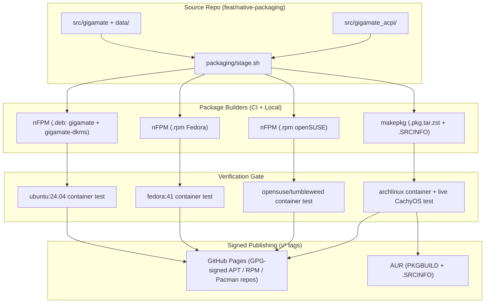

# GigaMate Native Packaging & Multi-Distro Release Pipeline — Implementation Plan

> **For agentic workers:** REQUIRED SUB-SKILL: Use `superpowers:subagent-driven-development` to implement this plan task-by-task on branch `feat/native-packaging` (branched from `feat/dgpu-power-gate` once the parallel agent session finishes). Steps use checkbox (`- [ ]`) syntax for tracking.

**Goal:** Package GigaMate as split native Linux packages (`gigamate` + `gigamate-dkms`) with transparent migration from `install.sh`, package-aware update prompts, GPG-signed APT/DNF/Zypper/Pacman repos on GitHub Pages + AUR, verified in 4-distro containers and live on CachyOS before v5.0 release.

**Architecture:** A single staging script (`packaging/stage.sh`) assembles standard FHS trees (`gigamate` and `gigamate-dkms`) with `/usr/lib/gigamate/py/` for Python-version independence, consolidated Polkit/udev vendor rules, and global systemd user presets. `nFPM` produces `.deb` and `.rpm` packages (Fedora + openSUSE) while `makepkg` produces Arch/CachyOS `.pkg.tar.zst` + `.SRCINFO`. Runtime code gains install-method detection (`updates.py`), transparent one-time user migration, iGPU-only clean exit (`dgpu_tune.py`), and dual-path diagnostics (`doctor.py`).

**Architecture Diagram:**



**Tech Stack:** Python 3.10+, PyQt6, `evdev`, `pytest`, Bash, `nFPM`, `makepkg`, `dpkg-scanpackages`, `apt-ftparchive`, `createrepo_c`, `repo-add`, GPG, GitHub Actions, GitHub Pages, Docker/Podman.

**Spec:** [design-spec-packaging-and-releases.md](file:///home/adriansc/.gemini/antigravity/brain/3d817dda-eb68-48cf-9bab-ac1c1d82652b/design-spec-packaging-and-releases.md) *(copy to `docs/superpowers/specs/2026-11-28-packaging-and-releases-design.md` as Task 0 on branch `feat/native-packaging`)*

## Global Constraints

- **Branch isolation:** All work happens on `feat/native-packaging` branched off `feat/dgpu-power-gate`; never touch `feat/dgpu-power-gate` or `main` until all tests and live CachyOS verification pass.
- **Zero `$HOME` writes during package build/install** except guarded `$SUDO_USER` legacy cleanup in `postinst` and runtime `migrate_legacy_user_install()`; `~/.config/gigamate/` must NEVER be modified or deleted.
- **No root daemon:** Keep 2 systemd user services + 3 single-shot Polkit helpers in `/usr/lib/gigamate/`.
- **Python version floor & immunity:** Python `>=3.10`; install package code to `/usr/lib/gigamate/py/gigamate/` across all distros so minor-version upgrades never break packaged binaries.
- **Abort safety:** `install.sh` and `uninstall.sh` remain functional; full rollback to `feat/dgpu-power-gate` + `./install.sh` must take `< 1 minute`.

---

## Phase 0 — Branch Setup & Spec Commit

### Task 0: Create `feat/native-packaging` Branch & Commit Design Spec

**Precondition:** Confirm the parallel agent session on `feat/dgpu-power-gate` has finished and committed its work (`git status` clean).

**Files:**
- Create: `docs/superpowers/specs/2026-11-28-packaging-and-releases-design.md`

- [ ] **Step 1: Verify clean baseline on `feat/dgpu-power-gate`**
  ```bash
  git status -sb
  pytest -q
  ```
  Expected: clean working tree and all existing tests pass.

- [ ] **Step 2: Create isolated feature branch**
  ```bash
  git checkout -b feat/native-packaging
  ```

- [ ] **Step 3: Copy approved design spec into repo & commit**
  ```bash
  mkdir -p docs/superpowers/specs
  cp /home/adriansc/.gemini/antigravity/brain/3d817dda-eb68-48cf-9bab-ac1c1d82652b/design-spec-packaging-and-releases.md \
     docs/superpowers/specs/2026-11-28-packaging-and-releases-design.md
  git add docs/superpowers/specs/2026-11-28-packaging-and-releases-design.md
  git commit -m "docs(spec): add native packaging and multi-distro release design"
  ```

---

## Phase 1 — Runtime Readiness (Python App & Rules)

### Task 1: Package-Aware Update Detection & Commands (`updates.py`, `tray.py`, `cli.py`)

**Files:**
- Modify: [src/gigamate/updates.py](file:///home/adriansc/Projects/GigaMate/src/gigamate/updates.py)
- Modify: [src/gigamate/tray.py](file:///home/adriansc/Projects/GigaMate/src/gigamate/tray.py#L307-L405)
- Modify: [src/gigamate/cli.py](file:///home/adriansc/Projects/GigaMate/src/gigamate/cli.py#L1615-L1635)
- Test: [tests/test_updates.py](file:///home/adriansc/Projects/GigaMate/tests/test_updates.py)

**Interfaces:**
- Produces:
  - `INSTALL_METHOD_FILE = Path("/usr/lib/gigamate/install-method")`
  - `detect_install_method(marker_path: Path = INSTALL_METHOD_FILE, which=shutil.which, run=subprocess.run) -> str` (returns `"apt" | "dnf" | "zypper" | "pacman" | "aur" | "script"`)
  - `is_package_managed(method: Optional[str] = None) -> bool`
  - `package_upgrade_command(method: str, which=shutil.which) -> Optional[str]`
  - `build_package_terminal_update_command(method: str, desktop: str = "", which=shutil.which, detect=None, env=None) -> Optional[list]`

- [ ] **Step 1: Write failing tests in `tests/test_updates.py`**
  ```python
  def test_detect_install_method_from_marker(tmp_path):
      marker = tmp_path / "install-method"
      marker.write_text("pacman\n", encoding="utf-8")
      assert updates.detect_install_method(marker_path=marker) == "pacman"
      assert updates.is_package_managed("pacman") is True

  def test_detect_install_method_falls_back_to_script(tmp_path):
      missing = tmp_path / "nope"
      assert updates.detect_install_method(
          marker_path=missing, which=lambda _: None
      ) == "script"
      assert updates.is_package_managed("script") is False

  def test_package_upgrade_commands():
      assert updates.package_upgrade_command("apt") == "sudo apt update && sudo apt upgrade gigamate gigamate-dkms"
      assert updates.package_upgrade_command("dnf") == "sudo dnf upgrade gigamate gigamate-dkms"
      assert updates.package_upgrade_command("zypper") == "sudo zypper update gigamate gigamate-dkms"
      assert updates.package_upgrade_command("pacman") == "sudo pacman -Syu gigamate gigamate-dkms"
      assert updates.package_upgrade_command("aur", which=lambda b: "/usr/bin/paru" if b == "paru" else None) == "paru -Syu gigamate gigamate-dkms"
      assert updates.package_upgrade_command("aur", which=lambda b: "/usr/bin/yay" if b == "yay" else None) == "yay -Syu gigamate gigamate-dkms"
      assert updates.package_upgrade_command("script") is None
  ```

- [ ] **Step 2: Run tests to verify failure**
  Run: `pytest tests/test_updates.py -k "install_method or package_upgrade" -v`
  Expected: FAIL (`AttributeError`).

- [ ] **Step 3: Implement `detect_install_method`, `is_package_managed`, `package_upgrade_command`, and `build_package_terminal_update_command` in `src/gigamate/updates.py`**
  ```python
  INSTALL_METHOD_FILE = Path("/usr/lib/gigamate/install-method")
  _VALID_PACKAGE_METHODS = frozenset({"apt", "dnf", "zypper", "pacman", "aur"})


  def detect_install_method(
      marker_path: Path = INSTALL_METHOD_FILE,
      which: Callable[[str], Optional[str]] = shutil.which,
      run: Callable = subprocess.run,
  ) -> str:
      """Return how GigaMate was installed: apt|dnf|zypper|pacman|aur|script."""
      try:
          if marker_path.is_file():
              val = marker_path.read_text(encoding="utf-8", errors="replace").strip().lower()
              if val in _VALID_PACKAGE_METHODS:
                  return val
      except OSError:
          pass
      exe = which("gigamate")
      if exe:
          for mgr, cmd in (
              ("pacman", ["pacman", "-Qo", exe]),
              ("apt", ["dpkg", "-S", exe]),
              ("dnf", ["rpm", "-qf", exe]),
          ):
              if not which(cmd[0]):
                  continue
              try:
                  proc = run(cmd, stdout=subprocess.DEVNULL, stderr=subprocess.DEVNULL, timeout=5)
                  if proc.returncode == 0:
                      if mgr == "dnf" and which("zypper") and not which("dnf"):
                          return "zypper"
                      return mgr
              except Exception:
                  continue
      return "script"


  def is_package_managed(method: Optional[str] = None) -> bool:
      m = detect_install_method() if method is None else method
      return m in _VALID_PACKAGE_METHODS


  def package_upgrade_command(
      method: str,
      which: Callable[[str], Optional[str]] = shutil.which,
  ) -> Optional[str]:
      if method == "apt":
          return "sudo apt update && sudo apt upgrade gigamate gigamate-dkms"
      if method == "dnf":
          return "sudo dnf upgrade gigamate gigamate-dkms"
      if method == "zypper":
          return "sudo zypper update gigamate gigamate-dkms"
      if method == "pacman":
          return "sudo pacman -Syu gigamate gigamate-dkms"
      if method == "aur":
          helper = "paru" if which("paru") else ("yay" if which("yay") else "paru")
          return f"{helper} -Syu gigamate gigamate-dkms"
      return None


  def build_package_terminal_update_command(
      method: str,
      desktop: str = "",
      which: Callable[[str], Optional[str]] = shutil.which,
      detect: Optional[Callable[..., Optional[Tuple[str, str]]]] = None,
      env: Optional[Mapping[str, str]] = None,
  ) -> Optional[list]:
      cmd = package_upgrade_command(method, which=which)
      if not cmd:
          return None
      return _open_terminal_with(
          f"{cmd}; exec bash", desktop=desktop, which=which, detect=detect, env=env
      )
  ```

- [ ] **Step 4: Wire package-aware branch into `tray.py:_on_update_clicked()` and `cli.py:cmd_update()`**
  - In `tray.py:_on_update_clicked()`: check `method = update_checker.detect_install_method()`. If `update_checker.is_package_managed(method)`, show a `QMessageBox` displaying `package_upgrade_command(method)` with Yes = open terminal running `build_package_terminal_update_command(method, ...)` and No = cancel (never calling `install.sh`).
  - In `cli.py:cmd_update()`: if `update_checker.is_package_managed(method)`, print `GigaMate is managed by <method>. Update with:\n  <cmd>` and exit `0` instead of invoking `install.sh`.

- [ ] **Step 5: Run tests & commit**
  ```bash
  pytest tests/test_updates.py tests/test_ui.py -q
  git add src/gigamate/updates.py src/gigamate/tray.py src/gigamate/cli.py tests/test_updates.py
  git commit -m "feat(updates): detect native package installs and show package-manager upgrade commands"
  ```

---

### Task 2: Transparent One-Time User Migration (`migrate_legacy_user_install()`)

**Files:**
- Modify: [src/gigamate/updates.py](file:///home/adriansc/Projects/GigaMate/src/gigamate/updates.py)
- Modify: [src/gigamate/tray.py](file:///home/adriansc/Projects/GigaMate/src/gigamate/tray.py) (call `migrate_legacy_user_install()` once on startup)
- Test: [tests/test_updates.py](file:///home/adriansc/Projects/GigaMate/tests/test_updates.py)

**Interfaces:**
- Produces: `migrate_legacy_user_install(home: Optional[Path] = None, state_file: Path = STATE_FILE, marker_path: Path = INSTALL_METHOD_FILE, run: Callable = subprocess.run) -> List[str]` (returns list of removed legacy paths; no-op if not package-managed or already migrated).

- [ ] **Step 1: Write failing tests in `tests/test_updates.py`**
  ```python
  def test_migrate_legacy_user_install_cleans_old_files_and_keeps_config(tmp_path):
      home = tmp_path / "home"
      marker = tmp_path / "install-method"
      marker.write_text("pacman\n", encoding="utf-8")
      state = home / ".config" / "gigamate" / "update_state.json"
      cfg = home / ".config" / "gigamate" / "config.json"
      cfg.parent.mkdir(parents=True)
      cfg.write_text('{"profile": 2}\n', encoding="utf-8")

      # Legacy pip binary + systemd unit + desktop entry
      bin_dir = home / ".local" / "bin"
      bin_dir.mkdir(parents=True)
      legacy_bin = bin_dir / "gigamate"
      legacy_bin.write_text("#!/usr/bin/python3\nfrom gigamate.cli import main\n", encoding="utf-8")
      custom_bin = bin_dir / "gigamate-tray"
      custom_bin.write_text("#!/bin/sh\necho custom user wrapper\n", encoding="utf-8")

      svc_dir = home / ".config" / "systemd" / "user"
      svc_dir.mkdir(parents=True)
      legacy_svc = svc_dir / "gigamate.service"
      legacy_svc.write_text("[Service]\nExecStart=/home/u/.local/bin/gigamate-tray\n", encoding="utf-8")

      removed = updates.migrate_legacy_user_install(
          home=home, state_file=state, marker_path=marker, run=lambda *a, **kw: None
      )
      assert str(legacy_bin) in removed
      assert not legacy_bin.exists()
      assert custom_bin.exists()  # non-pip custom script preserved
      assert str(legacy_svc) in removed
      assert not legacy_svc.exists()
      assert cfg.exists() and '"profile": 2' in cfg.read_text()
      assert updates.load_state(state).get("migrated_to_pkg") is True

      # Second call is a no-op
      assert updates.migrate_legacy_user_install(
          home=home, state_file=state, marker_path=marker, run=lambda *a, **kw: None
      ) == []
  ```

- [ ] **Step 2: Run test to verify failure**
  Run: `pytest tests/test_updates.py -k "migrate_legacy_user_install" -v`

- [ ] **Step 3: Implement `migrate_legacy_user_install()` in `src/gigamate/updates.py` and call it at tray startup (`tray.py:main()`)**
  - Only runs when `is_package_managed(detect_install_method(marker_path=marker_path))` is `True` and `not load_state(state_file).get("migrated_to_pkg")`.
  - Removes `~/.local/bin/{gigamate,gigamate-tray,gigamate-center,gigamate-dgpu-watch}` **only** if file contains `gigamate.` (pip console script signature).
  - Removes `~/.config/systemd/user/{gigamate.service,gigamate-dgpu.service}` **only** if file contains `.local/bin/gigamate`.
  - Removes `~/.local/share/applications/{gigamate.desktop,gigamate-center.desktop}` and `~/.local/share/icons/hicolor/scalable/apps/{gigamate*.svg,checkbox-checked.svg}`.
  - Calls `systemctl --user daemon-reload` if any unit was removed.
  - Marks `migrated_to_pkg = True` in `state_file`.

- [ ] **Step 4: Run tests & commit**
  ```bash
  pytest tests/test_updates.py -q
  git add src/gigamate/updates.py src/gigamate/tray.py tests/test_updates.py
  git commit -m "feat(migration): transparently clean legacy install.sh user files on first packaged launch"
  ```

---

### Task 3: iGPU-Only Clean Exit in `dgpu_tune.py` & Dual-Path Checks in `doctor.py`

**Files:**
- Modify: [src/gigamate/dgpu_tune.py](file:///home/adriansc/Projects/GigaMate/src/gigamate/dgpu_tune.py#L942-L975)
- Modify: [src/gigamate/doctor.py](file:///home/adriansc/Projects/GigaMate/src/gigamate/doctor.py#L22-L26)
- Test: [tests/test_dgpu_tune.py](file:///home/adriansc/Projects/GigaMate/tests/test_dgpu_tune.py)
- Test: [tests/test_install.py](file:///home/adriansc/Projects/GigaMate/tests/test_install.py)

- [ ] **Step 1: Write failing tests**
  - In `tests/test_dgpu_tune.py`: verify `has_discrete_gpu()` returns `False` when no NVIDIA/discrete AMD PCI device and no `/run/gigamate-dgpu-gate.json` exist, and `run_watcher()` returns immediately (exit 0) without entering the polling loop.
  - In `tests/test_install.py`: verify `doctor.py` accepts `/usr/lib/udev/rules.d/70-gigamate.rules` as a valid installed udev rule and flags shadowed legacy files when `/usr/lib/gigamate/install-method` exists alongside `~/.local/bin/gigamate`.

- [ ] **Step 2: Run tests to verify failure**
  Run: `pytest tests/test_dgpu_tune.py tests/test_install.py -k "has_discrete_gpu or vendor_udev" -v`

- [ ] **Step 3: Implement changes**
  - Add `has_discrete_gpu() -> bool` in `dgpu_tune.py` (checks `/run/gigamate-dgpu-gate.json` or `/sys/bus/pci/devices/*` for NVIDIA `0x10de` class `0x0300*`/`0x0302*` or non-UMA AMD `0x1002` class `0x0302*`). Call at top of `run_watcher()`; if `False`, log info `"No discrete GPU detected; exiting cleanly."` and `return`.
  - In `doctor.py`, define `VENDOR_RULE_PATH = Path("/usr/lib/udev/rules.d/70-gigamate.rules")` and accept either `VENDOR_RULE_PATH` or `RULE_PATH` when checking udev rule installation; add a shadow warning check when `is_package_managed()` is True and `~/.local/bin/gigamate` or `/etc/polkit-1/rules.d/50-gigamate-*.rules` exist.

- [ ] **Step 4: Run tests & commit**
  ```bash
  pytest tests/test_dgpu_tune.py tests/test_install.py -q
  git add src/gigamate/dgpu_tune.py src/gigamate/doctor.py tests/test_dgpu_tune.py tests/test_install.py
  git commit -m "feat(services): exit dgpu watcher cleanly on iGPU-only laptops and support vendor udev path in doctor"
  ```

---

### Task 4: Consolidate Vendor Polkit Rule, DMI-Guarded SmartShift udev Rule & Systemd User Preset

**Files:**
- Create: `data/50-gigamate.rules` (merged vendor Polkit rule covering `dgpu.control`, `dgpu-gate.control`, `repair.driver`, and `nvidia-powerd.service`)
- Create: `data/90-gigamate.preset` (`enable gigamate.service` + `enable gigamate-dgpu.service`)
- Modify: [data/99-gigamate-smartshift.rules](file:///home/adriansc/Projects/GigaMate/data/99-gigamate-smartshift.rules) (add DMI vendor guard `ATTR{[dmi/id]sys_vendor}=="*GIGABYTE*|*AORUS*|*GIGA-BYTE*|*Gigabyte*"`)
- Modify: [uninstall.sh](file:///home/adriansc/Projects/GigaMate/uninstall.sh) (add `--keep-config` flag for manual fallback cleanup)
- Test: [tests/test_install.py](file:///home/adriansc/Projects/GigaMate/tests/test_install.py)

- [ ] **Step 1: Create `data/50-gigamate.rules` and `data/90-gigamate.preset`**
- [ ] **Step 2: Update `data/99-gigamate-smartshift.rules` with DMI vendor match**
- [ ] **Step 3: Add `--keep-config` flag to `uninstall.sh` (non-interactive preservation of `~/.config/gigamate`)**
- [ ] **Step 4: Add unit tests validating `data/50-gigamate.rules` covers all 4 Polkit actions and `data/90-gigamate.preset` enables both user units**
- [ ] **Step 5: Run tests & commit**
  ```bash
  pytest tests/test_install.py -q
  git add data/50-gigamate.rules data/90-gigamate.preset data/99-gigamate-smartshift.rules uninstall.sh tests/test_install.py
  git commit -m "feat(packaging): add consolidated polkit rule, systemd user preset, and DMI-guarded smartshift rule"
  ```

---

## Phase 2 — Packaging Scripts, nFPM Configs & Arch PKGBUILD

### Task 5: Canonical FHS Staging Script (`packaging/stage.sh`) & Package Lifecycle Scripts

**Files:**
- Create: `packaging/stage.sh`
- Create: `packaging/scripts/postinst-app.sh`
- Create: `packaging/scripts/postrm-app.sh`
- Create: `packaging/scripts/postinst-dkms.sh`
- Create: `packaging/scripts/prerm-dkms.sh`
- Test: `tests/test_packaging_stage.py`

**Interfaces:**
- `packaging/stage.sh <version> <install-method> <out-dir>` populates:
  - `<out-dir>/app/` — full FHS tree for `gigamate` (including generated `/usr/bin/gigamate*` launchers with `sys.path.insert(0, "/usr/lib/gigamate/py")`, `/usr/lib/gigamate/py/gigamate/`, `/usr/lib/gigamate/install-method`, `/usr/lib/systemd/user/*.service` with `ExecStart=/usr/bin/...`, preset, udev, Polkit, `.desktop`, and all `data/*.svg` icons).
  - `<out-dir>/dkms/` — `/usr/src/gigamate_acpi-<version>/` (with `PACKAGE_VERSION="<version>"` stamped into `dkms.conf`) + `/usr/lib/modules-load.d/gigamate_acpi.conf`.
- `postinst-app.sh` performs:
  1. Legacy `/etc/` cleanup (only files matching GigaMate header; modified unrecognized files moved to `*.pre-pkg.bak`).
  2. Guarded `$SUDO_USER` legacy `~/.local/bin/gigamate*` + `~/.config/systemd/user/gigamate*.service` cleanup + `systemctl --user daemon-reload && systemctl --user restart gigamate.service` (never touching `~/.config/gigamate/`).
  3. `udevadm control --reload-rules && udevadm trigger --subsystem-match=hidraw --subsystem-match=usb`.
  4. `systemctl --global enable gigamate.service gigamate-dgpu.service`.

- [ ] **Step 1: Write failing test `tests/test_packaging_stage.py`** verifying `packaging/stage.sh 5.0.0 pacman <tmp>` produces every expected FHS file, valid executable `/usr/bin/gigamate*` launchers, stamped `dkms.conf`, and `install-method` content `"pacman"`.
- [ ] **Step 2: Run test to verify failure**
- [ ] **Step 3: Implement `packaging/stage.sh` and `packaging/scripts/*.sh`**
- [ ] **Step 4: Run `pytest tests/test_packaging_stage.py -v` and `bash -n packaging/stage.sh packaging/scripts/*.sh`**
- [ ] **Step 5: Commit**
  ```bash
  git add packaging/ tests/test_packaging_stage.py
  git commit -m "feat(packaging): add canonical FHS staging script and lifecycle hooks"
  ```

---

### Task 6: nFPM Definitions (Debian/Ubuntu, Fedora, openSUSE) & Arch Split PKGBUILD

**Files:**
- Create: `packaging/nfpm/gigamate-deb.yaml`
- Create: `packaging/nfpm/gigamate-dkms-deb.yaml`
- Create: `packaging/nfpm/gigamate-fedora.yaml`
- Create: `packaging/nfpm/gigamate-dkms-fedora.yaml`
- Create: `packaging/nfpm/gigamate-opensuse.yaml`
- Create: `packaging/nfpm/gigamate-dkms-opensuse.yaml`
- Create: `packaging/arch/PKGBUILD.tmpl`
- Create: `packaging/arch/gigamate.install`
- Create: `packaging/build-local-arch.sh` (convenience script to build `.pkg.tar.zst` locally on Arch/CachyOS from current checkout)

- [ ] **Step 1: Create all 6 `packaging/nfpm/*.yaml` templates** (using `${VERSION}` and `${STAGE_DIR}` env vars, exact per-distro dependencies from Spec §2.4, and postinst/prerm/postrm scripts from Task 5).
- [ ] **Step 2: Create `packaging/arch/PKGBUILD.tmpl` (split package `pkgname=('gigamate' 'gigamate-dkms')`, `arch=('any')`) and `packaging/arch/gigamate.install`** (calling the same legacy cleanup + `systemctl --global enable` logic in `post_install`/`post_upgrade`).
- [ ] **Step 3: Create `packaging/build-local-arch.sh`** (generates `PKGBUILD` from `PKGBUILD.tmpl` pointing at local git archive, runs `makepkg -sf` in a temp build dir, outputs `.pkg.tar.zst` files to `dist/arch/`).
- [ ] **Step 4: Validate YAML syntax, `bash -n`, and `namcap` (if installed on CachyOS)**
- [ ] **Step 5: Commit**
  ```bash
  git add packaging/
  git commit -m "feat(packaging): add nFPM definitions for deb/rpm and Arch split PKGBUILD"
  ```

---

## Phase 3 — Local CachyOS Proof-of-Concept & 4-Distro Container Verification

### Task 7: Live Local CachyOS Build, Migration & End-to-End Verification

> [!IMPORTANT]
> Run this task **before** touching CI/GitHub Pages or merging `feat/native-packaging`. Every `sudo` command will be explicitly explained and confirmed per user rule.

- [ ] **Step 1: Create pre-test backup & snapshot current state**
  ```bash
  cp -a ~/.config/gigamate ~/.config/gigamate.pre-pkg-backup
  which -a gigamate gigamate-tray gigamate-center gigamate-dgpu-watch
  dkms status
  systemctl --user status gigamate.service gigamate-dgpu.service --no-pager
  ```

- [ ] **Step 2: Build Arch/CachyOS packages locally**
  ```bash
  ./packaging/build-local-arch.sh
  ls -la dist/arch/*.pkg.tar.zst
  ```

- [ ] **Step 3: Inspect package contents before installing**
  ```bash
  tar -tf dist/arch/gigamate-*.pkg.tar.zst | head -n 60
  tar -tf dist/arch/gigamate-dkms-*.pkg.tar.zst
  ```

- [ ] **Step 4: Live migration test (requires explicit user confirmation for `sudo`)**
  ```bash
  sudo pacman -U dist/arch/gigamate-dkms-*.pkg.tar.zst dist/arch/gigamate-*.pkg.tar.zst
  ```

- [ ] **Step 5: Run full live verification checklist**
  - `which -a gigamate` → only `/usr/bin/gigamate` (no `~/.local/bin/gigamate` shadow)
  - `ls ~/.config/systemd/user/gigamate* 2>/dev/null` → empty (using `/usr/lib/systemd/user/`)
  - `ls /etc/udev/rules.d/*gigamate* /etc/polkit-1/rules.d/50-gigamate-*.rules 2>/dev/null` → empty (using `/usr/lib/` & `/usr/share/`)
  - `diff -r ~/.config/gigamate.pre-pkg-backup ~/.config/gigamate` → config intact
  - `dkms status` & `lsmod | grep gigamate_acpi` → driver built & loaded for running CachyOS kernel
  - `gigamate doctor` → all checks green
  - `systemctl --user status gigamate.service gigamate-dgpu.service` → both active from `/usr/lib/systemd/user/`
  - Verify tray icon, GigaMate Center, profile switch, RGB, and "Check for updates" shows `pacman -Syu` instructions.

- [ ] **Step 6: Test clean uninstall & rollback (optional verification of Abort Plan)** — confirm `sudo pacman -Rns gigamate gigamate-dkms` leaves zero orphan files.

---

### Task 8: Multi-Distro Container Smoke Test Suite (`packaging/test-containers.sh`)

**Files:**
- Create: `packaging/test-containers.sh`

- [ ] **Step 1: Create `packaging/test-containers.sh`** that builds local `.deb`, `.rpm` (Fedora + openSUSE), and `.pkg.tar.zst` packages and runs clean container tests (Docker or Podman) on:
  - `ubuntu:24.04` (local APT repo + GPG verify + `apt install gigamate` + `gigamate version` + legacy `/etc/` migration test + `apt remove`)
  - `fedora:41` (local DNF repo + GPG verify + `dnf install gigamate` + `gigamate version` + `dnf remove`)
  - `opensuse/tumbleweed` (local Zypper repo + GPG verify + `zypper install gigamate` + `gigamate version` + `zypper remove`)
  - `archlinux:latest` (local Pacman repo + GPG verify + `pacman -S gigamate` + `gigamate version` + `pacman -Rns`)
- [ ] **Step 2: Run `./packaging/test-containers.sh` locally (if docker/podman available) or via GitHub Actions workflow_dispatch**
- [ ] **Step 3: Commit**
  ```bash
  git add packaging/test-containers.sh
  git commit -m "test(packaging): add 4-distro container smoke test suite"
  ```

---

## Phase 4 — CI/CD Release Pipeline & Documentation

### Task 9: Automated Release Workflow (`.github/workflows/release.yml`) & Repo Publisher

**Files:**
- Modify: [.github/workflows/release.yml](file:///home/adriansc/Projects/GigaMate/.github/workflows/release.yml)
- Create: `packaging/publish-repos.sh` (generates GPG-signed APT, Fedora RPM, openSUSE RPM, and Arch Pacman repo metadata into `site/repo/`)

- [ ] **Step 1: Implement `packaging/publish-repos.sh`** (idempotent repo metadata builder + GPG signer for all 4 repo trees, preserving previous package versions or keeping latest cleanly).
- [ ] **Step 2: Update `.github/workflows/release.yml`** with the 5 jobs from Spec §5.3 (`build-packages` → `verify-packages` 4-distro matrix → `publish-release` → `publish-repos` to `gh-pages` → `publish-aur` on stable tags when `AUR_SSH_PRIVATE_KEY` is present). Also add `workflow_dispatch` trigger so we can dry-run on `feat/native-packaging` before tagging!
- [ ] **Step 3: Run `actionlint` / YAML check & commit**
  ```bash
  git add .github/workflows/release.yml packaging/publish-repos.sh
  git commit -m "ci(release): build, verify, sign, and publish multi-distro repos on release tags"
  ```

---

### Task 10: README & Installation Docs Update (v5.0 Native-First)

**Files:**
- Modify: [README.md](file:///home/adriansc/Projects/GigaMate/README.md)

- [ ] **Step 1: Update README Install section** to lead with clean copy-paste native repo install blocks for:
  - Arch / CachyOS (`pacman` repo + AUR `paru -S gigamate`)
  - Debian / Ubuntu / Pop!_OS / Mint (`apt`)
  - Fedora (`dnf`)
  - openSUSE (`zypper`)
  - Fallback / Other distros (`install.sh` — clearly labeled as fallback)
- [ ] **Step 2: Add one-time GPG + GitHub Pages + AUR setup checklist in `docs/RELEASE.md`** for future releases.
- [ ] **Step 3: Commit**
  ```bash
  git add README.md docs/RELEASE.md
  git commit -m "docs: make native distro repositories the primary install method for v5.0"
  ```

---

## Abort / Rollback Runbook (Zero-Risk Escape Hatch)

If at any point during Tasks 0–10 you decide to abort and return to the current `install.sh` setup:

```bash
# 1. If native packages were installed on your CachyOS machine, remove them cleanly:
sudo pacman -Rns gigamate gigamate-dkms

# 2. Switch back to feat/dgpu-power-gate and restore the current install.sh setup:
git checkout feat/dgpu-power-gate
./install.sh

# 3. (Only if needed) Restore config snapshot:
# cp -a ~/.config/gigamate.pre-pkg-backup/. ~/.config/gigamate/

# 4. Discard the experimental branch:
git branch -D feat/native-packaging
```

Zero impact on `feat/dgpu-power-gate`, zero impact on `main`, zero impact on existing users.
