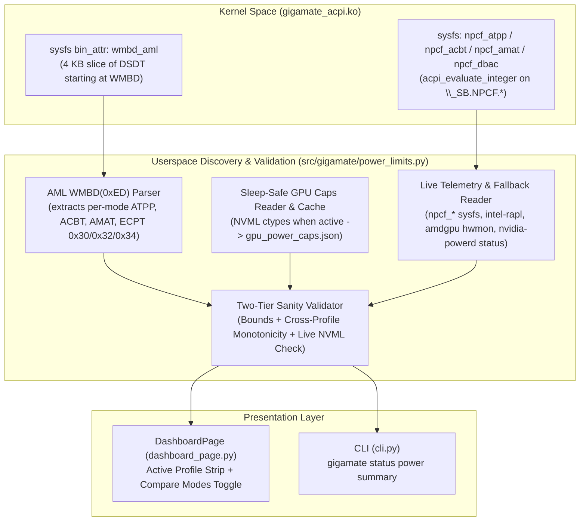

# Automatic Power-Limit Discovery & Sanity-Check Engine — Design Specification

**Date:** 2026-04-19
**Status:** Approved
**Scope:** Kernel driver (`gigamate_acpi`), hardware discovery & validation (`src/gigamate/power_limits.py`), CLI status (`src/gigamate/cli.py`), and GigaMate Center Dashboard UI (`src/gigamate/ui/pages/dashboard_page.py`).

---

## 1. Goal & Problem Statement

Gigabyte laptops adjust CPU, GPU, and combined platform power limits across the 4 hardware thermal profiles (`Quiet = 0`, `Balanced = 1`, `Performance = 2`, `Gaming = 3`) via ACPI method `AMW0.WMBD(0, 0xED, mode)`. Previously, users had no visibility into what each profile actually changed on their specific laptop model without installing third-party tools (`ryzenadj`, `nvidia-smi`, `acpica`/`iasl`) or dumping and submitting their ACPI `DSDT` tables.

This specification defines an **automatic, zero-configuration power-limit discovery and sanity-check engine** that:
1. Discovers the four core power metrics per profile directly from firmware and kernel interfaces:
   - **Combined Limit (`CPU + GPU`)**: Total shared platform power budget when both CPU and dGPU are under load.
   - **Max CPU Limit**: Sustained (`Slow PPT` / `PL1`) and burst (`Fast PPT` / `PL2`) standalone CPU limits, plus shared CPU floor (`STAPM` / `ATPP`).
   - **Max GPU Limit (without Dynamic Boost)**: Base VBIOS TGP + per-profile configurable TGP (`cTGP` / `ACBT`) offset.
   - **Max GPU Limit (with Dynamic Boost)**: Peak GPU ceiling when `nvidia-powerd` (or AMD SmartShift) adds the Dynamic Boost offset (`AMAT`).
2. Requires **no external binaries** (`ryzenadj`, `nvidia-smi`, `iasl`) and **no manual JSON authoring or DSDT submissions** from users.
3. Enforces **strict two-tier sanity checks** (per-metric physical bounds + cross-profile monotonicity + live NVML cross-check) and adheres to the **Rule of Clean Absence**: any metric that cannot be verified or fails sanity validation is hidden rather than guessed or displayed as `0W`/`Unknown`.
4. Preserves GigaMate's **dGPU sleep-safety invariant**: never calls NVML while the dGPU is in `D3cold`/`D3hot` (`runtime_status != "active"`).

---

## 2. Firmware & Hardware Mechanics

### 2.1 NVIDIA `NVPCF` (`\_SB.NPCF` / `NVDA0820`)
On NVIDIA-equipped Gigabyte laptops (both AMD Ryzen and Intel Core platforms, including `Aero X16`, `EAGLE 9MJ`, `GAMING A16`, `AORUS 16X`), `WMBD(0, 0xED, mode)` updates the `\_SB.NPCF` ACPI device before issuing `Notify(NPCF, 0xC0)` to `nvidia-powerd`.

All `NPCF` power variables are stored in **`1/8 Watt` (`125 mW`) units** (`Watts = raw_value // 8`), confirmed by `WMBD` subcommands `0x4A` (`NPCF.AMAT = Arg2 * 8`) and `0x4C` (`NPCF.ACBT = Arg2 * 8`):

- **`\_SB.NPCF.ACBT`** (`cTGP` offset): Power offset added above the GPU's VBIOS Default Power Limit (`default_tgp_w`).
  $$\text{GPU}_{\text{fixed}} = \text{TGP}_{\text{default}} + \frac{\text{ACBT}}{8}$$
- **`\_SB.NPCF.AMAT`** (Max Dynamic Boost offset): Additional boost headroom granted by `nvidia-powerd` when Dynamic Boost is enabled in the profile (`DBAC == 0` and `ACBT > 0` or `AMAT > 0` with `DBAC == 0`).
  $$\text{GPU}_{\text{boost}} = \min\!\left(\text{TGP}_{\text{max\_constraint}},\; \text{GPU}_{\text{fixed}} + \frac{\text{AMAT}}{8}\right)$$
  *(Note: In `Quiet (0)` mode on Gigabyte firmware, `ACBT == 0` disables Dynamic Boost scaling, capping GPU power at `GPU_fixed`.)*
- **`\_SB.NPCF.ATPP`** (Total Processor Power / Shared CPU Floor): The CPU's sustained power allocation when the dGPU is simultaneously loaded.
  $$\text{CPU}_{\text{shared}} = \frac{\text{ATPP}}{8}$$
- **Combined (`CPU + GPU`) Base Platform Budget**:
  $$\text{Combined}_{\text{base}} = \text{CPU}_{\text{shared}} + \text{GPU}_{\text{fixed}}$$
  *(For example, on `Gigabyte Aero X16`: `Quiet = 20W + 50W = 70W`, `Balanced = 25W + 60W = 85W`, `Performance = 30W + 70W = 100W`, `Gaming = 25W + 70W = 95W` base / `110W` w/ Dynamic Boost).*

### 2.2 Standalone CPU Limits (`ECPT` on AMD vs `intel-rapl` on Intel)
- **AMD CPU Platforms (`ECPT`)**: Inside `WMBD (0xED)`, the `If (ACST == 1)` (AC power) branch calls `ECPT(reg, watts)` where `watts` is in **direct integer Watts**:
  - `ECPT(0x30, W)`: Shared/STAPM floor (`cpu_shared_w`).
  - `ECPT(0x32, W)`: Standalone CPU sustained limit (`Slow PPT` / `cpu_sustained_w`).
  - `ECPT(0x34, W)`: Standalone CPU burst limit (`Fast PPT` / `cpu_burst_w`).
  - In raw AML bytecode, these compile to `45 43 50 54 0a <reg> 0a <watts>`. Within each profile's `If (ACST == 1)` block (prior to the `0xA1` `ElseOp` battery branch), the **last** write to each register (`0x30`, `0x32`, `0x34`) is the effective AC wattage.
- **Intel CPU Platforms (`intel-rapl`)**: Intel Gigabyte models do not use `ECPT`; standalone CPU `PL1` (sustained) and `PL2` (burst) are exposed by the kernel in `/sys/class/powercap/intel-rapl:0/constraint_0_power_limit_uw` and `constraint_1_power_limit_uw` (world-readable, in microwatts), while shared `CPU + GPU` allocation still uses `\_SB.NPCF.ATPP`.

### 2.3 Discrete GPU Base TGP Discovery (Sleep-Safe NVML & AMD `hwmon`)
- **NVIDIA dGPU**: `libnvidia-ml.so.1` (loaded via `ctypes`, no `nvidia-smi` binary needed) provides:
  - `nvmlDeviceGetPowerManagementDefaultLimit` $\rightarrow$ `default_tgp_w` (e.g. `50W`).
  - `nvmlDeviceGetEnforcedPowerLimit` $\rightarrow$ `live_enforced_w` (e.g. `50W`, `60W`, `70W`).
  - `nvmlDeviceGetPowerManagementLimitConstraints` $\rightarrow$ `(min_constraint_w, max_constraint_w)` (e.g. `(5W, 85W)`).
  - **Sleep-Safety Rule**: NVML is **only** invoked when `/sys/bus/pci/devices/<bdf>/power/runtime_status == "active"`. Once queried while awake, `{pci_device_id, default_tgp_w, max_constraint_w}` is persisted to `~/.config/gigamate/gpu_power_caps.json`. When the dGPU is `suspended` (`D3cold`), GigaMate reads `default_tgp_w` and `max_constraint_w` from this cache without waking the GPU.
- **AMD dGPU**: Reads `/sys/class/drm/card*/device/hwmon/hwmon*/power1_cap` (and `power1_cap_default` / `power1_cap_max` in microwatts) when the device is active.

---

## 3. Architecture & Component Responsibilities



### 3.1 Kernel Module (`src/gigamate_acpi/gigamate_acpi.c`)
1. **Live `NPCF` Read-Only Attributes (`0444`)**:
   - `npcf_atpp`: Evaluates `\_SB.NPCF.ATPP` (returns integer in `1/8 W` units, or `-ENODATA` if `\_SB.NPCF` is absent).
   - `npcf_acbt`: Evaluates `\_SB.NPCF.ACBT`.
   - `npcf_amat`: Evaluates `\_SB.NPCF.AMAT`.
   - `npcf_dbac`: Evaluates `\_SB.NPCF.DBAC`.
2. **Read-Only Binary Attribute `wmbd_aml` (`0444`, max `4096` bytes)**:
   - On module probe, uses `acpi_get_table(ACPI_SIG_DSDT, 0, &dsdt)` to locate the `"WMBD"` method signature inside the DSDT, copies up to `4096` bytes starting at `"WMBD"` into a static kernel buffer (`wmbd_aml_buf`), and calls `acpi_put_table(dsdt)`.
   - Exposes only the `WMBD` method slice via `BIN_ATTR_RO(wmbd_aml, 4096)` so unprivileged userspace can parse all 4 profile branches of `WMBD (0xED)` without needing root access to `/sys/firmware/acpi/tables/DSDT`.

### 3.2 Discovery & Sanity Engine (`src/gigamate/power_limits.py`)
Defines immutable data models and the discovery/validation pipeline:

```python
@dataclass(frozen=True)
class ProfilePowerLimits:
    profile_id: int                      # 0=Quiet, 1=Balanced, 2=Performance, 3=Gaming
    combined_w: Optional[int] = None     # Shared CPU + Fixed GPU (e.g. 70, 85, 100, 95)
    cpu_shared_w: Optional[int] = None   # CPU floor under combined load (e.g. 20, 25, 30, 25)
    cpu_sustained_w: Optional[int] = None # Standalone CPU sustained / Slow PPT / PL1 (e.g. 65, 65, 80, 80)
    cpu_burst_w: Optional[int] = None    # Standalone CPU burst / Fast PPT / PL2 (e.g. 65, 80, 80, 80)
    gpu_fixed_w: Optional[int] = None    # GPU limit without Dynamic Boost (e.g. 50, 60, 70, 70)
    gpu_boost_w: Optional[int] = None    # GPU limit with Dynamic Boost (e.g. 50, 75, 85, 85)

    @property
    def has_any(self) -> bool: ...

@dataclass(frozen=True)
class SystemPowerLimits:
    profiles: Dict[int, ProfilePowerLimits] = field(default_factory=dict)
    dynamic_boost_supported: bool = False
    dynamic_boost_active: bool = False   # Whether nvidia-powerd.service is currently active
    on_battery: bool = False             # True if AC power is offline (limits suppressed/noted)
    source: str = "none"                 # "acpi+nvml", "acpi-only", "live-only", "mock", "none"
```

### 3.3 Two-Tier Sanity-Check Rules
Every extracted profile table is validated before any field is exposed:

1. **Tier 1 — Per-Metric Physical Plausibility Bounds**:
   - `gpu_fixed_w`: integer in `[25, 185]` W.
   - `gpu_boost_w`: integer in `[gpu_fixed_w, 220]` W, with `0 <= (gpu_boost_w - gpu_fixed_w) <= 35` W.
   - `cpu_shared_w`: integer in `[10, 95]` W.
   - `cpu_sustained_w`: integer in `[15, 140]` W; if `cpu_shared_w` is present, must satisfy `cpu_sustained_w >= cpu_shared_w`.
   - `cpu_burst_w`: integer in `[cpu_sustained_w, 180]` W.
   - `combined_w`: integer in `[45, 260]` W; must equal `cpu_shared_w + gpu_fixed_w`.
   - Any individual field failing its bound check is nulled (`None`) without crashing.

2. **Tier 2 — Cross-Profile & Live Hardware Consistency**:
   - **Monotonicity across `Quiet (0) -> Balanced (1) -> Performance (2)`**:
     - If `gpu_fixed_w` is present for `0, 1, 2`, require `gpu_fixed_w[0] <= gpu_fixed_w[1] <= gpu_fixed_w[2]`.
     - If `combined_w` is present for `0, 1, 2`, require `combined_w[0] <= combined_w[1] <= combined_w[2]`.
     - If `cpu_sustained_w` is present for `0, 2`, require `cpu_sustained_w[0] <= cpu_sustained_w[2]`.
     - If a category violates monotonicity across modes, all static AML-derived values for that category are discarded (`None`).
   - **Live NVML Cross-Check**:
     - When the dGPU is `active`, if `live_enforced_w` from NVML is available and the active profile is known, `abs(gpu_fixed_w[active_profile] - live_enforced_w) <= 2` must hold. If it diverges by `> 2W` (e.g. on battery or unusual VBIOS), static `gpu_fixed_w` / `gpu_boost_w` / `combined_w` projections are suppressed in favor of verified live state.

3. **Clean-Absence & Battery Rule**:
   - When running on battery (`on_battery == True`), firmware applies reduced battery caps (`ECPT` `Else` branch). Rather than showing AC wattages that do not apply on battery, the UI either hides the AC power strip or displays a subtle `"AC power limits paused on battery"` note.
   - If `has_any` is `False` for the active profile, the entire power-limits strip and comparison button are hidden (`setVisible(False)`).

### 3.4 UI Design in GigaMate Center (`src/gigamate/ui/pages/dashboard_page.py`)
Inside the **Power & Thermal Profiles** card, directly below the profile selector buttons (`Quiet | Balanced | Performance | Gaming`):
1. **Active Profile Power Strip (`self.power_limits_frame`)**:
   - A horizontal row of up to 4 compact pills showing only validated, non-`None` metrics for the currently selected profile:
     - **Combined (`CPU + GPU`)**: e.g. `100 W` *(sublabel: `30W CPU + 70W GPU`)*
     - **Max CPU**: e.g. `80 W` *(sublabel: `80W sustained · 80W burst` or `65W sustained · 80W burst`)*
     - **GPU (Fixed)**: e.g. `70 W` *(sublabel: `Base + cTGP`)*
     - **GPU (Dynamic Boost)**: e.g. `Up to 85 W` *(sublabel: `nvidia-powerd active` or `Requires nvidia-powerd` if inactive)*
2. **"Compare Modes" Toggle (`self.btn_compare_limits` + `self.compare_table_frame`)**:
   - Shown whenever at least 2 profiles have validated limits (`len(limits.profiles) >= 2`).
   - Clicking `"Compare Modes ▾"` toggles a compact 4-column comparison grid inside the card showing `Quiet`, `Balanced`, `Performance`, and `Gaming` rows for each available metric (`Combined`, `CPU Max`, `GPU Fixed`, `GPU w/ Boost`), highlighting the currently active profile column.
   - Any row whose metric is `None` across all profiles is omitted.
